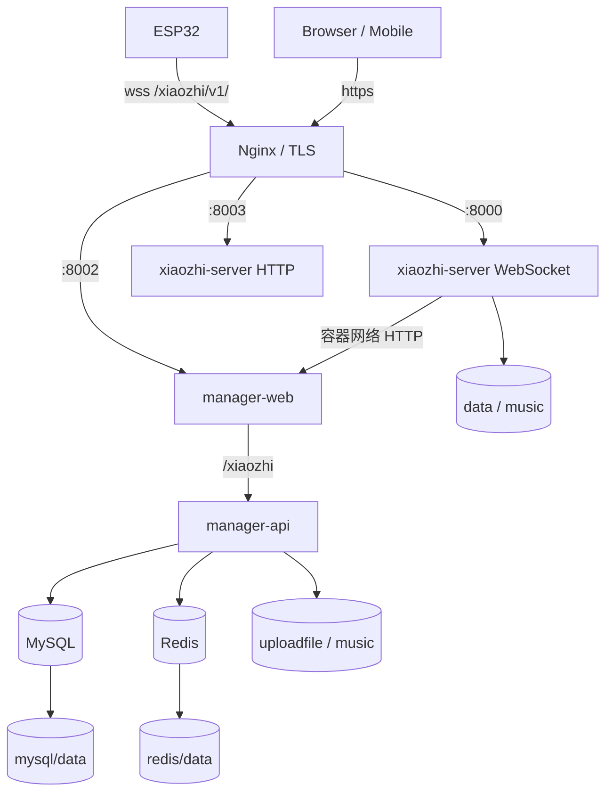

# 部署架构

本文解释部署拓扑与边界，不替代操作教程。生产操作只使用 [ACR 镜像生产部署](../deployment/private-docker-release.md)。

## 1. 部署形态

| 形态 | 组件 | 配置来源 | 用途 |
| --- | --- | --- | --- |
| 单模块开发 | `xiaozhi-server` | `config.yaml` + 私有覆盖 | 实时链路和 provider 调试 |
| 全模块开发 | 四个业务模块 + MySQL + Redis | 本地应用配置 | 跨模块联调 |
| 生产容器 | 发布镜像 + 持久卷 + TLS 代理 | `.env`、私有配置、数据库 | 正式设备和管理服务 |

本地开发统一通过 `scripts/dev` 管理；Python 必须运行在项目 Conda 环境。

## 2. 生产拓扑



生产 Compose 对外映射 `8000`、`8002`、`8003`，但主机防火墙应限制直接访问并优先只暴露 TLS 代理。MySQL `3306` 和 Redis `6379` 只在容器网络暴露。

## 3. 网络路由

推荐外部路由：

```text
https://domain/                    -> manager-web :8002
https://domain/xiaozhi/            -> manager-api via manager-web proxy
wss://domain/xiaozhi/v1/           -> xiaozhi-server :8000
https://domain/mcp/vision/explain  -> xiaozhi-server :8003
https://domain/device/mcp/         -> xiaozhi-server :8003
```

容器内 Python 的 manager-api 地址使用服务名，不使用宿主机回环地址。设备收到的 URL 必须是设备实际可达的域名或 LAN 地址，不能下发容器名、WSL 私网地址或 `127.0.0.1`。

## 4. 持久化与配置

| 内容 | 持久位置 | 保护要求 |
| --- | --- | --- |
| Python 私有配置、认证密钥和设备数据 | `data` 卷 | 不提交、不出现在日志 |
| 音乐和媒体 | `music` 卷 | 校验版权、路径和容量 |
| 上传文件 | `uploadfile` 卷 | MIME、扩展名和路径校验 |
| 业务数据库 | MySQL 数据卷 | 发布前备份、迁移后验证 |
| Redis | Redis 数据卷 | 密码保护，可从事实层恢复 |
| 生产变量 | 数据目录 `.env` | 强权限、禁止提交 |

发布镜像是不可变应用资产；配置、数据库、上传和运行日志是环境资产，不能烘焙进镜像或反向提交到仓库。

## 5. 启动依赖与健康

推荐顺序为 MySQL/Redis 健康 -> manager-api 健康 -> manager-web -> xiaozhi-server。Compose 的 `depends_on` 只能表达启动条件，应用仍必须处理依赖短暂不可用、重试和超时。

健康检查至少覆盖：容器进程、Java API、Web 静态服务、Python HTTP、WebSocket 端口、MySQL、Redis。端口可达不等于 provider 或设备链路可用，模型与实时链路需要独立合成监控。

## 6. 发布与恢复

标准发布链路：本地完成验证 -> 构建版本化镜像 -> 推送私有 ACR -> 生产拉取指定版本 -> 备份数据库 -> 执行 Liquibase -> 健康检查与设备抽样。

恢复必须分别处理：

- 应用回滚：切回上一已验证镜像，不修改或清理构建缓存。
- 数据恢复：使用发布前备份；已执行 Liquibase changeSet 不能通过编辑旧 SQL 回退。
- 配置恢复：恢复受控 `.env` 和私有配置版本，确认密钥未泄漏。
- 设备恢复：确认 OTA、WSS、视觉地址和 Token 仍与恢复后的服务匹配。

## 7. 容量与可观测性

生产资源预算应优先保障 Python 实时语音和本地 ASR；Java、Web、MySQL、Redis 使用明确 CPU、内存、PID 和日志上限。容量评估观察活跃连接、ASR/LLM/TTS 延迟、音频队列、工具错误、JVM、数据库连接、Redis 内存和磁盘增长，不以单次空闲资源判断容量。
