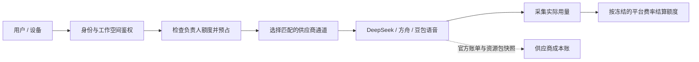

# 平台中转计费与供应商通道池改造方案

本文记录 2026-10-13 共享供应商通道的实现与迁移边界；部署状态以发布验收为准。
新调用按模型选择平台通道，旧凭据仅保留历史引用及在途兼容。
相关现状见[平台服务与运营隔离](platform-service-and-operations.md)和[产品化蓝图](platform-product-blueprint.md)。

## 1. 结论与产品规则

平台统一提供模型服务、以平台服务额度结算时，不必为每个用户申请、占用或分配供应商 API Key。
把“谁使用、谁承担平台额度”与“本次调用走哪个供应商通道”分开管理。

- 用户注册自动建立用户身份、自己的工作空间和额度账户；登录、设备连接使用已有认证凭证，不再等待供应商密钥分配。
- 在某工作空间内调用，继续扣该空间固定负责人的平台额度；协作者不改扣自己的账户。
- 用户已明确仅供自有小程序和设备内部使用，不开放第三方软件调用；当前不新增长期用户 API Key 或对外模型代理 API。
- 自有网页、小程序和设备继续使用现有登录或设备认证，用户正常操作无需手工复制密钥；这些身份入口汇入同一权限和计费链。
- 服务端统一管理少量供应商账号、调用通道及其加密凭据，不再维护“20 套官方 Key 对应 20 个用户”的库存机制。
- 员工仍按现有三个岗位授权，无超级管理员，不开放用户聊天、音频、私人记忆或知识库正文。
- 用户额度只由运营发放，用户界面不增加充值、申请额度或支付入口。

## 2. 最小架构

复用现有 manager-api 的控制与账本、xiaozhi-server 的真实模型执行，不增加独立代理网关或新的微服务。
首次改造按模型配置一个通道，支持人工更新凭据或停用；不同时引入复杂权重、自动比价和跨模型重试。

| 对象 | 职责 | 不承担的职责 |
| --- | --- | --- |
| 现有用户会话 / 设备凭证 | 识别访问身份、配合资源权限和服务准入 | 上游供应商鉴权或独立拥有余额 |
| 用户 / 工作空间额度账户 | 发放、冻结、预占、扣减与流水 | 保存上游 Key 的所有权 |
| 供应商账号 | 官方余额、账单、资源包和账号范围限流的归属 | 映射成某一个平台用户 |
| 调用通道 | 供应商账号、能力、地域/项目、合法端点、可用模型、启用状态和并发约束 | 按注册用户复制 |
| 通道凭据及版本 | 加密保存、更新、停用、记录具体调用版本 | 提供给用户或在页面回显 |
| 调用记录 | 冻结付款人、空间、智能体、设备、模型、通道、凭据版本、用量与结果 | 保存聊天正文供运营查看 |

建议初始按 DeepSeek LLM、火山方舟 LLM、豆包 ASR、豆包 TTS 配置能力通道。
同一语音凭据在产品授权允许时可以被 ASR/TTS 通道引用，不强求一通道一把独立 Key。
实际需要的凭据数量取决于账号隔离、能力授权、地域和容灾，不取决于用户数。
同一主账号下多个 Key 可能共享余额和限流，不能把轮换 Key 当作扩容能力。

### 注册即建立服务账户，复用内部认证

“注册自动获得密钥”的使用诉求，是用户注册后不用准备或配置供应商 Key 就能使用平台。
用户已确认只在自有小程序和设备使用，因此采用已有用户会话和设备认证即可，不另建一套长期 API Key 库存、发放、复制和重置界面。
内部用户 ID 是稳定身份，不能当作可直接调用的秘密；认证仍由实际会话和设备凭证完成。

注册初始化为“用户 → 默认工作空间 → 额度账户”，普通注册和微信自动建号走同一幂等初始化。
登录时签发用户会话，设备按现有绑定关系认证；每次调用由服务端复核目标工作空间、模型与设备归属，
确定负责人付款账户，再执行额度预占和平台通道选择。客户端不能自行指定可信付款人、单价或最终消费金额。

成员使用自己的登录身份或获授权设备参与协作，不复制、共享负责人的任何凭证。
账目归属稳定的用户、空间和调用记录；登录过期、换手机或供应商密钥轮换都不创建新额度账户、不改变历史账目。
注册、登录重试只补齐缺项，不重复发放额度。注册本身不等于已发余额，仍遵循运营发放或明确启用的试用政策。

现有 USER / OPS / 服务端内部身份隔离继续保留，普通用户及设备不得进入 `/ops/**` 或内部结算接口。
未来确需第三方模型 API 时，再单独设计受限平台 API Key、一次交付、摘要存储和专用调用入口；本阶段不实现、不展示。

## 3. 三种记录分别展示

| 记录 | 数据来源 | 使用范围 |
| --- | --- | --- |
| 实际调用用量 | 供应商返回 token、缓存命中等用量，或对应语音协议的可信计量 | 按工作空间、智能体、设备和调用查看 |
| 平台服务额度流水 | 实际用量与本次冻结的平台费率；预占与最终扣减分开 | 判断用户还能用多少、由哪个负责人承担 |
| 供应商实际费用 | 官方账单、抵扣记录及资源包快照；保留币种、期间和证据 | 核对平台真实支出、余额与资源包使用情况 |

平台费率计算的是平台服务额度扣减，不标成供应商实际成本。官方未返回足够粒度的费用证据时，
不能把共享账号费用按 token 比例分摊后标为“该用户的实际供应商费用”，也不能用余额差冒充消费账单。
如果将来供应商提供可关联的请求级费用证据，再按请求标识关联；否则保留账号/项目/资源级成本事实。

这项区分符合此前“平台额度与供应商消费不强制直接关联”的产品决定。
用户界面显示自己的额度、空间用量及扣减流水；官方账单与资源包主要在运营端查看。

当前设备调用已经有可信空间、智能体、设备归属和负责人付款归属，但设备语音不一定对应已登录的具体成员。
实际操作者未知时保留未知，不能把付款负责人冒充说话人；将来需要成员用量时再接入可信成员身份。

## 4. 资源包与通道选择

资源包是否抵扣取决于供应商规定的账号、项目、产品、模型、地域、资源 ID、有效期及抵扣规则，
不是简单增加 API Key 就能解决。平台通道应记录这些匹配维度，以便解释“有资源包却仍产生现金费用”。

第一阶段提供只读信息：余额、资源包余量/有效期、当前通道使用的产品与资源、已知不匹配项以及数据更新时间。
缺少官方证据时明确显示未知。资源包购买、续费、切换仍不在后台执行。
自动推荐或调整路由应等产品匹配规则和真实账单核验完成后再做，不能依据配置单价承诺实际节省。

## 5. 界面收敛

运营的“额度与密钥”可调整为“模型与额度”，保留用户额度、供应商通道、服务定价、平台任务。
供应商通道主表只显示名称、能力/模型、配置与启用状态、最近调用结果、操作。
供应商凭据和官方账号更新放到配置抽屉；官方余额及资源包仍在财务界面，取消逐用户分配、待分配用户队列和批量备货主流程。
用户端不出现新增的访问密钥、开发者接入或 Key 复制/重置界面；账户停用、会话与设备认证沿用既有管理流程。

通道“已配置 / 已启用”和“最近调用成功”是不同事实；不能用密钥数量或未校验的配置冒充健康状态。
余额查询和通道配置检查不触发付费模型测试。需要真实调用的测试仍沿用显式平台任务预算与权限。

用户额度页仅展示额度和模型服务状态，不出现供应商 Key、密钥不足或密钥待分配等内部实现词汇。

## 6. 已核实的改造位置

| 当前实现 | 保留 | 调整 |
| --- | --- | --- |
| `SysUserServiceImpl.provisionPlatformAccount` / `PlatformAccountService.ensureUser` | 注册额度初始化与试用幂等、既有用户身份 | 取消对 `credentials.initialize(userId)` 的依赖，覆盖普通和微信建号；不增加另一套用户 API Key |
| `PlatformAdmissionService` | 可信路由、付款人校验、预占/续占、费率冻结、幂等结算、UNKNOWN 处理 | 把 `credentials.active(payer, provider)` 改为按模型、能力和通道策略选择；增加通道/账号快照 |
| `PlatformCredentialService` | 加密、秘密去重、版本、吊销 | 用户所有权和 active 指针不再是新调用的选择条件；抽取独立通道凭据服务 |
| `PlatformRuntimeService` | 已发布模型、适配器和官方端点白名单 | 校验通道与模型及语音能力匹配；地域/项目为核对元数据，不自动改变端点 |
| `BillingContextService` / `BillingUsageService` / `BillingUsageRecorder` | 由可信资源关系冻结归属、验签入账 | 统一可信 `reservationId / attemptId` 与通道/供应商账号关联，覆盖 Python 和 Java 内部调用，不接受客户端自报成本归属 |
| Python `core/metering/` 及 Java 模型执行 | 每次调用准入、真实用量采集、可靠补传、运行结束清除秘密 | 使用准入返回的通道快照；检查共享凭据后的缓存/会话隔离 |
| 服务状态、试用、平台任务与计量界面 | 预算和用途约束、岗位限制 | 从“用户有独立 Key”改成“所需模型存在有效通道” |

现有供应商费用归属使用 `provider + account_ref + ACCOUNT/PROJECT/RESOURCE` 及有效期，
没有把用户凭据 ID 当作官方费用归属条件。因此独立用户 Key 并没有自动解决真实用户成本对账。
Python 与 Java 内部用量事件均带 `attemptId`，Java 同时传入 `reservationId`；入账服务仅从冻结许可补充通道及账号元数据，并验证模型/空间/智能体/设备归属。派生元数据不参与旧事件摘要，兼容已经持久化的补传重试。
DeepSeek 财务查询目前仅配置一个独立账号，不能把“已导入多个运行 Key”当作“已支持多账号账单”。
财务查询凭据继续与模型运行凭据分开管理。

## 7. 迁移与验收

1. 通过新增 Liquibase 迁移建立通道及凭据关联，保留现有用户凭据、流水、官方费用证据和已发布迁移。
2. 配置各能力所需的少量平台专用供应商凭据；旧 20 套退出用户分配流程，不把保留全部旧 Key 作为新架构要求。切换完成并核对运行中请求及其他应用依赖后，停用、撤销多余官方 Key；已有账目及非秘密版本引用保留，不能删除被历史引用的记录。本方案不直接执行供应商撤销。
3. 新准入逻辑按明确模式选择平台通道。现有 reservation 继续使用原凭据版本与路由快照完成结算，不在半次调用中改 Key。
4. 切换用户服务状态与注册流程，保留既有登录/设备认证，移除逐用户上游 Key 库存阻塞，保留零额度、停用、模型未发布等真实拒绝条件。
5. 审查共享账号的历史费用绑定。新时期不得把整个共享账号费用继续归给单个工作空间；保留旧账期证据与有效边界。
6. 灰度验证新调用、额度和通道日志后扩大范围。回滚只影响后续新准入，旧请求、密钥版本及结算补传必须仍可完成。

最低验收覆盖：多用户共用通道仍分别计量；协作者调用仅扣空间负责人；并发超额被拒绝；重试不重复扣减；
用量未知不伪装为零消费；通道停用/轮换不串改历史记录；LLM/ASR/TTS 匹配独立验证；
运营岗位不能读取用户内容；生产测试不得未经安排自动导入、分配、购买资源包或调用付费模型。
增加注册与身份验收：普通/微信建号、重试只生成一个默认账户；无上游用户库存仍可正常注册；
既有用户/设备认证与 OPS 隔离不退化；无权限空间、伪造付款人或消费金额被拒绝；会话更新前后余额与账目连续。

共享凭据也不能共享用户会话、聊天历史或不含租户标识的缓存。
遇到超时或已开始流式输出的请求，不自动在另一通道重放；未来增加故障切换时，每个实际尝试必须单独计量并保留未知结果。
