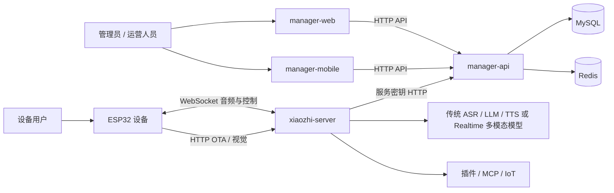
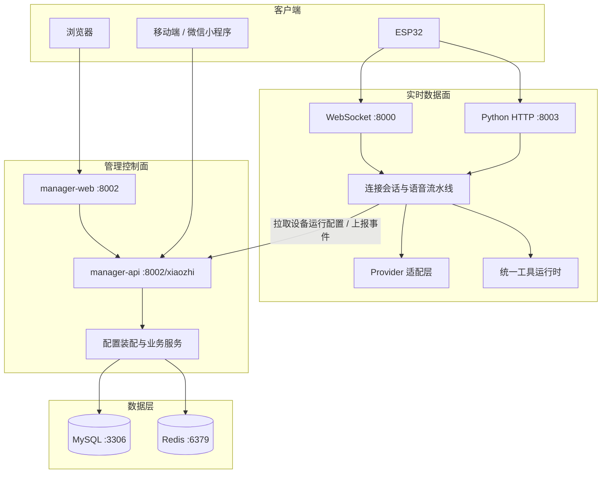
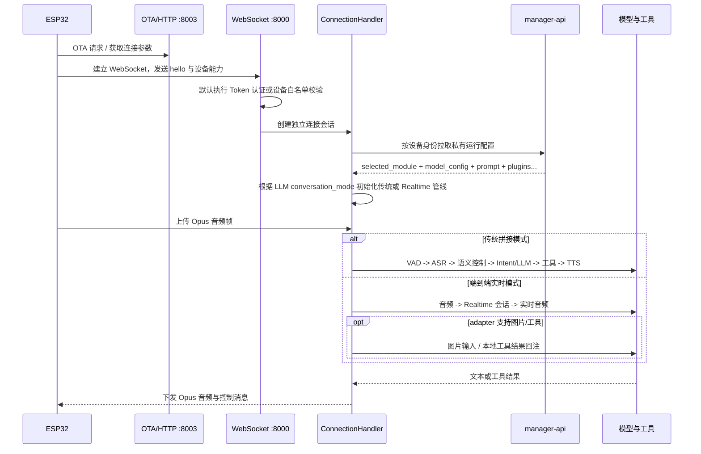

# 项目完整架构

本文是项目级架构的唯一总览，回答系统由什么组成、边界在哪里、一次设备对话和一次配置变更如何流动。按任务继续阅读时从[文档门户](../README.md)进入对应专题。

## 1. 系统定位

`xiaozhi-esp32-server` 是端云协同语音智能体平台，分为两个运行平面：

- 实时数据面：ESP32 与 `xiaozhi-server` 保持实时连接，完成音频、语义、模型和工具调用。
- 管理控制面：Web/Mobile 通过 `manager-api` 管理智能体、设备、模型、知识库、记忆、OTA 和权限，并向实时服务提供运行配置。



## 2. 容器与模块边界



| 模块 | 核心职责 | 不应承担的职责 |
| --- | --- | --- |
| `main/xiaozhi-server` | 实时连接、VAD/ASR/LLM/TTS、会话语义、工具/MCP、Python HTTP | 用户后台管理、业务数据事实存储 |
| `main/manager-api` | 配置事实、权限、业务编排、数据库迁移、运行配置下发 | 伪造模型运行结果、处理实时音频 |
| `main/manager-web` | Web 管理交互与结果展示 | 直接调用 provider、实现服务端鉴权 |
| `main/manager-mobile` | H5/iOS/Android/微信管理交互 | 复制一套独立后端业务规则 |
| MySQL | 持久业务事实和 Liquibase 管理的结构 | 会话内高频状态 |
| Redis | 缓存、短生命周期状态和配置加速 | 明文密钥的长期事实来源 |

### 2.1 源码导航

| 模块 | 稳定入口 | 主要分层 |
| --- | --- | --- |
| xiaozhi-server | `main/xiaozhi-server/app.py` | `core/handle/` 协议与音频，`core/providers/` 模型，`core/semantic/` 控制，`plugins_func/` 插件 |
| manager-api | `main/manager-api/src/main/java/xiaozhi/AdminApplication.java` | `modules/config/` 配置装配，`modules/model/` 模型，`modules/knowledge/` 与 `modules/memory/` 数据能力，`modules/security/` 安全 |
| manager-web | `main/manager-web/src/main.js` | `views/` 页面，`components/` 领域组件，`apis/` 请求封装 |
| manager-mobile | `main/manager-mobile/src/main.ts` | `pages/` 页面，`api/` 与 `http/` 请求，`store/` 状态 |

`core/connection.py` 只协调单设备会话；关闭生命周期继续下沉到 `core/session/`，会话观测进入
`core/observability/`。数据库结构只能通过 `main/manager-api/src/main/resources/db/changelog/` 修改。

## 3. 设备实时双轨主链路

设备连接只有一套认证、配置、工具、聊天记录和关闭生命周期，但会话执行分成两条互斥管线。智能体仍只选择一个
`llmModelId`；Python 根据该模型 `typed_config.conversation_mode` 路由，不新增第二个智能体主模型字段。

| 会话模式 | 选择条件 | 音频主链路 | 图片与工具 |
| --- | --- | --- | --- |
| 传统拼接 `pipeline` | 未配置 `conversation_mode`，或值不是 `realtime` | VAD -> ASR -> SemanticCenter -> Intent/LLM -> TTS | 图片走独立 VLLM；工具按统一工具运行时回注 LLM |
| 端到端实时 `realtime` | 所选 LLM 的 `typed_config.conversation_mode=realtime` | 设备音频直接进入 Realtime provider，由上游统一完成判停、转写、生成和音频输出 | 图片和工具能力按 adapter 声明；Qwen 支持图片/本地工具回注，豆包当前均不支持 |

传统 VAD、ASR、TTS 和 VLLM 选择在实时模式下保留为智能体配置事实，但不参与当前实时会话主链路。切回普通 LLM 后
这些配置重新生效；实时上游连接或响应失败时不允许静默切到传统链路，因为这会改变本轮音频、工具、上下文和审计语义。



传统链路的稳定顺序是：

```text
连接认证 -> 设备配置装配 -> 音频接收 -> VAD -> ASR
-> 语义控制中枢（固定播报技能优先） -> Intent / 主 LLM -> 工具或 MCP
-> TTS -> 音频回传 -> 事件与聊天记录上报
```

播放打断在音频接收层按 AEC barge-in 处理；退出游戏等状态控制先进入语义控制中枢，未处理的输入再进入旧 Intent 和主 LLM。工具统一由服务端插件、Server MCP、Device IoT、Device MCP、MCP Endpoint 五类来源聚合，冲突时先注册者保留。

Realtime 链路复用同一连接认证、运行配置、工具门控、聊天记录、记忆事件和设备音频协议，但不创建传统 ASR/TTS
provider。上游输入转写完成事件负责 STT 展示与 user 上报，回复文本/音频增量负责 assistant 文本累积与设备音频下发，
`response.done`、取消或异常必须收敛当前回复状态。图片 HTTP 入口只能把图片交给已认证且已绑定的活动设备连接，不能凭
请求中的任意 deviceId 新建或控制会话。

具体能力不能由 `conversation_mode` 推断。`qwen_omni_realtime` 支持受限 JPG/JPEG 图片和本地 Function Calling
结果回注；`doubao_realtime` 当前只接入音频/文本轮次，图片请求明确失败，本地工具保持服务端门控但不向豆包暴露。

这里的“记忆复用”只保证会话事件上报和建立会话时可注入的静态摘要，不表示 Realtime 自动拥有传统
`Connection.chat()` 的逐轮动态记忆查询。server VAD 自动响应模式下，基于每轮 query 的托管召回暂不等同于传统链路；
需要动态记忆维护或离线总结时应配置独立传统文本 LLM，或采用托管/仅上报记忆模式。

## 4. 配置控制链路

Web 或 Mobile 保存智能体运行配置后，控制面在事务提交后通知 Python 在线刷新；Python 在安全轮次边界重新拉取并热替换连接级 provider，设备 WebSocket 不需要重连。通知失败时，下一轮对话前的配置指纹检查负责兜底。服务启动级参数和设备固件能力不属于连接级热更新范围。

Web 智能体中心以“我的智能体 / 智能体模板”分离实例和可复用配置；模板中心按官方、审核通过的社区模板和当前工作空间模板展示。模板卡片只负责检索，用户必须先进入只读预览查看人设、模型、音色、能力、标签、语义技能和明确的复制边界，再确认创建；预览不调用模型，也不产生模型费用。用户从模板创建智能体时，manager-api 在同一事务内完成配额校验、实例创建、模板版本校验和快照应用，任一步失败都不保留半成品实例，并保留用户输入的实例名称。角色配置页还支持把当前草稿另存为工作空间共享角色模板。模板快照覆盖角色字段、模型、TTS 音色、热词、插件、知识库、上下文源、固定播报技能、标签、替换词、声纹绑定和飞书集成；工作空间模板的语音绑定只在同一工作空间使用，官方模板可以绑定平台统一维护且已验证的 TTS 模型、音色和官方知识库，普通用户投稿的跨工作空间公共快照仍剥离 TTS、传统音色和 Realtime 音色。所有模型、音色和知识库都在预览或应用时重新校验，失效资源保留目标角色当前配置并返回可见警告。超级管理员本人及其团队成员通过统一官方资源维护权限编辑系统默认模板。应用模板由 manager-api 在事务内更新配置事实，并在提交后沿用同一在线刷新链路。声纹只保存同工作空间资源引用，不复制生物特征或样本；飞书 App Secret 与 Verification Token 会从智能体作用域解密后立即以模板 ID 为 AES-GCM AAD 重新加密，应用时再重加密到目标智能体作用域，模板接口不返回密文或明文。设备绑定、聊天/长期记忆事实和上下文源认证请求头仍不进入模板；失效的插件、知识库、替换词或声纹引用会跳过并返回可见警告。

运行时模型契约为：

```text
selected_module.<moduleType> = modelId
model_config.<modelId>.model_type = moduleType
model_config.<modelId>.typed_config = provider 初始化配置
```

主 LLM 会话模式是 `typed_config` 的运行时能力字段：

```yaml
selected_module:
  LLM: LLM_QwenOmniRealtime
model_config:
  LLM_QwenOmniRealtime:
    model_type: LLM
    adapter_code: qwen_omni_realtime
    typed_config:
      type: qwen_omni_realtime
      conversation_mode: realtime
```

`conversation_mode` 缺省即保持传统拼接行为。控制面不得仅凭厂商名或模型名猜测实时模式；Realtime、普通 WebSocket、
OpenAI Compatible 和 Chat Completions 是不同协议，必须绑定对应 adapter 和真实测试契约。

Java 的 `ModelRuntimeAssembler` 负责从通用字段、普通参数和密钥参数组装 `typed_config`；Python 的 `normalize_runtime_config()` 负责标准化并为旧调用点构造兼容视图。新增模型配置能力必须保持这条契约，不能让前端字段或 Java 实体直接泄漏到 provider。

其他主要下发内容包括：

| 字段 | 运行时用途 |
| --- | --- |
| `prompt` | 智能体角色与基础系统提示词输入 |
| `summaryMemory` | 兼容记忆摘要上下文 |
| `plugins` | 已启用插件及运行时参数；天气/联网搜索会合并智能体所有者的用户级共享配置 |
| `semantic_skills` | 已启用的智能体固定播报技能；命中后绕过 LLM 并复用当前 TTS |
| `mcp_endpoint` | 外部 MCP Endpoint |
| `context_providers` | 动态上下文源 |
| `voiceprint` | 外置声纹服务配置、`user_id=agentId` 和最多 5 条说话人信息 |
| `plugins.feishu_assistant` | 智能体级飞书能力开关，不包含 App Secret |

完整时序见 [运行时链路](./runtime-flows.md)，字段责任见 [数据与契约](./data-and-contracts.md)。

## 5. 能力地图

| 领域 | 控制面 | 实时面 | 权威专题 |
| --- | --- | --- | --- |
| 模型 | 配置、目录、测试、评测任务、会话模式标签 | 传统 provider 或 Realtime 会话初始化与真实调用 | [模型评测与助手](./model-benchmark-and-assistant.md) |
| 语音 | 模型和音色配置 | 传统 VAD/ASR/TTS 或端到端 Realtime、打断 | [设备交互链路](./device-interaction-chain.md) |
| 工具 | 插件启用与参数 | 统一工具注册、冲突和执行 | [功能插件](./function-plugin-architecture.md) |
| MCP | Endpoint 和工具配置 | Server/Device/Endpoint 三类 MCP | [MCP 链路](./mcp-chains.md) |
| 记忆 | 事实、候选、审计、查询 | 事件上报与上下文注入 | [记忆系统](./memory-system-chain.md) |
| 知识库 | 文件、分块、检索与权限 | 检索工具调用并回注 LLM | [知识库链路](./knowledge-base-chain.md) |
| 人物与接待 | 人物、人脸、客户、预约、FAQ/餐品/座位和二维码配置 | 单人识别兼容协议与批量 `reception_v1` | [人物资源](./person-resource-and-face-sync.md)、[机器人迎宾产品化](./robot-reception-productization.md) |
| Workspace | 成员、角色和资源归属 | 配置拉取时的资源授权边界 | [工作空间隔离](./workspace-organization-management.md) |

## 6. 数据所有权

- `manager-api + MySQL` 是用户、智能体、设备绑定、人物档案、模型、知识库元数据/处理状态、长期记忆和 Workspace 的事实来源；本地知识库的内容事实来源是持久化卷中的上传原件，MySQL 切片用于兼容现有管理链路，Lucene 是可重建的检索索引。
- 天气和联网搜索的外部服务凭据属于用户级事实；智能体映射只决定是否启用插件并保存非共享行为参数。
- `xiaozhi-server` 拥有连接级会话状态、音频队列、当前对话和工具客户端生命周期。
- Redis 是加速层；缓存失效不能改变 MySQL 的事实语义。
- 设备拥有固件、NVS 中的连接入口和设备侧能力描述，但设备上报不能绕过服务端工具门控。
- `config.yaml` 是可提交模板；真实密钥和环境私有配置只能进入受保护的运行配置。

## 7. 安全与信任边界

- 设备 WebSocket 认证默认开启；只有显式白名单设备可旁路 Token。
- Python HTTP 的视觉与设备 MCP 接口使用 Bearer Token 或共享密钥；OTA 保持匿名入口并配套限流。
- Java 管理接口默认进入 Shiro OAuth2 过滤器；匿名和服务端接口必须显式登记。
- `/config/**` 由 `ServerSecretFilter` 校验共享密钥，但资源型接口仍必须校验 agent、device 或 workspace 归属。
- 用户输入 URL 必须经过 SSRF 校验；文件路径必须防止路径穿越；日志不得记录原始凭据。
- Realtime 上游只允许受支持 adapter 的 HTTPS/WSS 官方端点白名单；API Key 只放厂商规定的鉴权请求头，不进入 URL、事件正文或日志。自定义端点必须先通过协议级 allowlist/SSRF 校验，避免把凭据发往任意主机。
- 图片帧属于用户输入，不写入日志；大小、格式和单事件字节数必须有上限。工具调用继续执行现有服务端白名单、资源所有权和同名冲突规则，Realtime 模型不能绕过门控直接调用设备描述符。
- 生产入口必须通过 TLS 反向代理提供 HTTPS/WSS，数据库和缓存不应暴露到公网。

详细控制见 [安全架构](./security-architecture.md)。

## 8. 部署形态

| 形态 | 组成 | 用途 |
| --- | --- | --- |
| 本地单模块 | `xiaozhi-server` + 文件配置 | provider 和设备链路开发验证 |
| 本地全模块 | 四个业务模块 + MySQL + Redis | 跨模块开发与配置联调 |
| 生产容器 | 发布镜像 + MySQL + Redis + TLS 反向代理 | 多设备正式运行 |

生产部署常驻 `xiaozhi-maintenance-agent`，使 DeepSeek Harness 维护工作台随每次发布和升级保持可用；资源维护
策略仍需按知识库或智能体逐一启用。该容器只是 DeepSeek Harness 协议适配器，不是新的事实库：manager-api
仍是策略、配额、权限、审批和写入权威。适配器没有宿主源码挂载，使用只读根文件系统；原生 Harness 会话只写入
专用 Docker volume，临时工作区位于 tmpfs。知识任务仅有搜索能力，记忆任务没有联网能力。即使容器已部署，
每个知识库或智能体仍需在页面单独 opt-in。
维护控制面的运行可观察性由 manager-api 持久化的脱敏里程碑事件提供，Web 只增量读取这些事件；容器 stdout、
完整组装提示词和模型隐藏推理不得暴露到浏览器。原生 Console 自己展示并管理人工会话，manager-web 不复制消息
或重建聊天界面。知识来源审批使用 `APPLYING → APPLIED/FAILED`
状态机，只有连接器完成原子发布后才能显示为已入库。
Web 在当前资源工作台中嵌入官方 Harness Console；会话新建、重命名、删除和完整消息交互由原生 Console 承载。
定时、手动和交互提交只在 Manager 外层作为运行审计，候选提案只在 Manager 外层审批。业务提示词可以约束版本、
时效、官方来源和排除项，但不能覆盖 Harness 固定安全合同、Manager API 审批、配额与 SSRF 门控。
Console 启动使用一次性 code 和 HttpOnly Cookie，浏览器写请求校验独立 Console origin；唯一提案回调同时校验
服务器内部密钥与当前 audit run 的 HMAC 能力令牌，不能跨运行复用。
维护使用的 DeepSeek 端点、上游模型名和凭据来自模型管理中策略显式选择且已测试通过的 LLM。策略只保存模型
配置 ID；凭据仅随 manager-api 的内部鉴权请求存在于单轮内存中，适配器不持久化，也不再要求部署环境维护
第二份 `DEEPSEEK_API_KEY`。

生产唯一操作入口是 [ACR 镜像生产部署](../deployment/private-docker-release.md)。推荐外部只暴露 TLS 入口：

```text
https://domain/                    -> manager-web :8002
https://domain/xiaozhi/            -> manager-api
wss://domain/xiaozhi/v1/           -> xiaozhi-server :8000
https://domain/mcp/vision/explain  -> xiaozhi-server :8003
```

MySQL `3306` 和 Redis `6379` 只在容器网络开放。设备收到的 URL 必须是设备实际可达的域名或 LAN 地址，
不能是容器名、WSL 私网地址或 `127.0.0.1`。私有配置、认证密钥、上传、音乐、数据库和 Redis 数据位于持久卷，
不得烘焙进镜像或提交到 Git。

启动和恢复边界：MySQL/Redis 健康后启动 manager-api，再启动 Web 与 xiaozhi-server；应用回滚切换到上一已验证
镜像，数据库恢复使用发布前备份，已执行的 Liquibase changeSet 不通过修改旧 SQL 回退。资源预算优先保障 Python
实时语音和本地 ASR，并对 Java、MySQL、Redis、PID 和日志设置明确上限。

## 9. 故障定位入口

| 现象 | 首查方向 |
| --- | --- |
| 后台保存后设备未变化 | 配置缓存、设备绑定、Python 拉取和重连时机 |
| 设备无法连接 | OTA 地址、TLS/WSS、WebSocket Token、设备白名单 |
| ASR/LLM/TTS 无输出 | 当前 `selected_module`、`typed_config`、conversation_mode、对应管线初始化和超时 |
| 实时模型连接成功但设备无声 | `session.update`、输入/输出采样率、首音频事件、PCM/Opus 转换、回复终态；不得自动切到传统 TTS 掩盖故障 |
| 图片没有进入实时会话 | 活动连接注册、设备/智能体归属、当前 conversation_mode、图片大小格式与上游事件结果 |
| 工具没有出现 | Intent 白名单、工具源连接、服务端门控和同名冲突 |
| 数据跨用户可见 | Workspace header 校验、资源实体归属、读写权限 |
| 知识库或记忆未生效 | 智能体绑定、检索范围、超时降级和上下文注入 |

开发前从[文档门户](../README.md)选择对应模块和领域文档，不应依赖临时分析报告或手写代码行数判断当前实现。

## 10. 验证入口

文档与自动事实执行 `scripts/docs-facts --check` 和 `scripts/docs-check`。代码按修改范围执行 Java `mvn test`、
Web `npm run test:unit && npm run build`、Mobile `pnpm test:unit && pnpm type-check && pnpm build:h5 && pnpm build:mp-weixin`；
Python 必须使用项目 Conda 环境运行 `compileall` 和测试。Realtime 改动至少覆盖模式路由、音频编解码、事件解析、
工具回注、图片入口、取消/关闭和 benchmark mock 测试；真实外部模型调用、长期服务和生产部署不属于默认验证。
