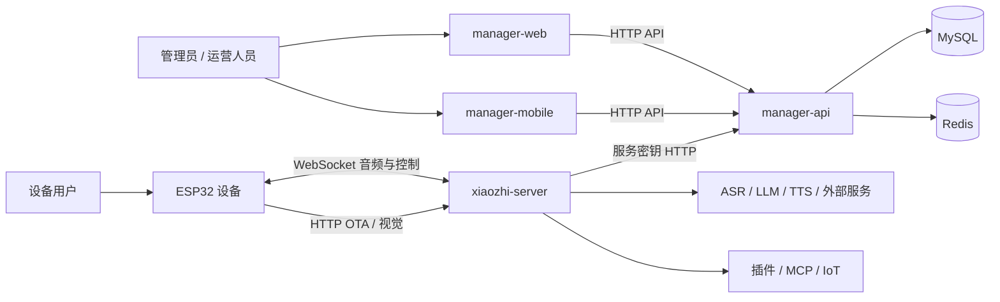
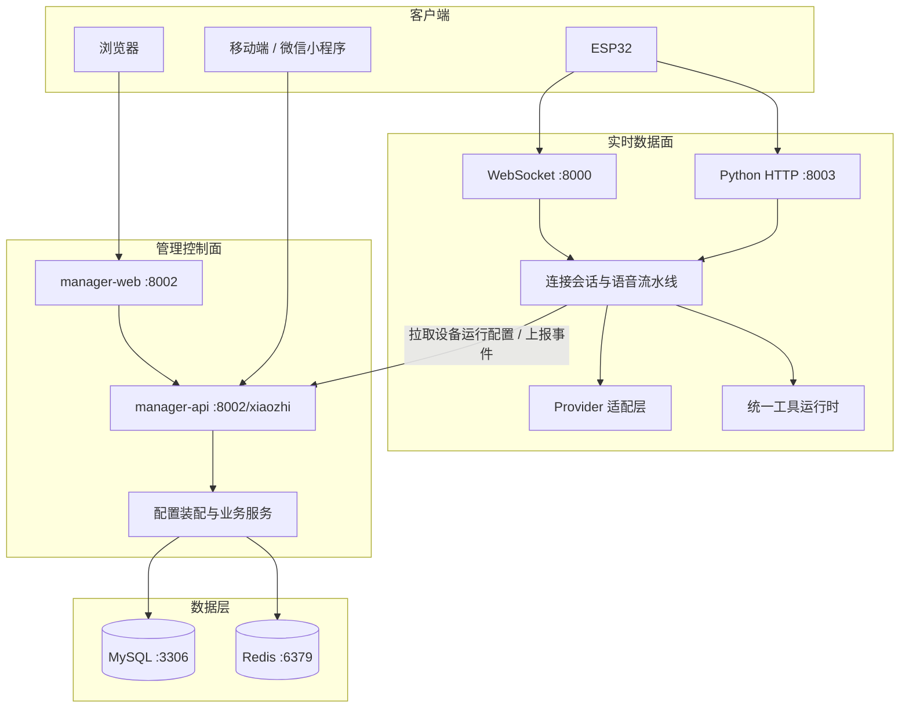
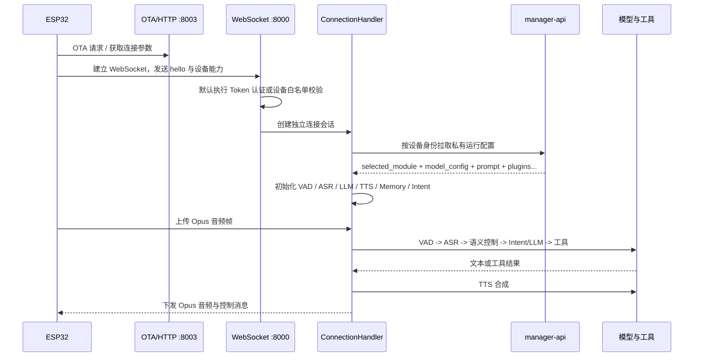

# 项目完整架构

本文是项目级架构的唯一总览，回答系统由什么组成、边界在哪里、一次设备对话和一次配置变更如何流动。按任务继续阅读时从[文档门户](../README.md)进入对应专题。

## 1. 系统定位

`xiaozhi-esp32-server` 是端云协同语音智能体平台，分为两个运行平面：

- 实时数据面：ESP32 与 `xiaozhi-server` 保持实时连接，完成音频、语义、模型和工具调用。
- 管理控制面：Web/Mobile 通过 `manager-api` 管理智能体、设备、模型、知识库、记忆、OTA 和权限，并向实时服务提供运行配置。



## 2. 容器与模块边界



| 模块 | 核心职责 | 不应承担的职责 |
| --- | --- | --- |
| `main/xiaozhi-server` | 实时连接、VAD/ASR/LLM/TTS、会话语义、工具/MCP、Python HTTP | 用户后台管理、业务数据事实存储 |
| `main/manager-api` | 配置事实、权限、业务编排、数据库迁移、运行配置下发 | 伪造模型运行结果、处理实时音频 |
| `main/manager-web` | Web 管理交互与结果展示 | 直接调用 provider、实现服务端鉴权 |
| `main/manager-mobile` | H5/iOS/Android/微信管理交互 | 复制一套独立后端业务规则 |
| MySQL | 持久业务事实和 Liquibase 管理的结构 | 会话内高频状态 |
| Redis | 缓存、短生命周期状态和配置加速 | 明文密钥的长期事实来源 |

### 2.1 源码导航

| 模块 | 稳定入口 | 主要分层 |
| --- | --- | --- |
| xiaozhi-server | `main/xiaozhi-server/app.py` | `core/handle/` 协议与音频，`core/providers/` 模型，`core/semantic/` 控制，`plugins_func/` 插件 |
| manager-api | `main/manager-api/src/main/java/xiaozhi/AdminApplication.java` | `modules/config/` 配置装配，`modules/model/` 模型，`modules/knowledge/` 与 `modules/memory/` 数据能力，`modules/security/` 安全 |
| manager-web | `main/manager-web/src/main.js` | `views/` 页面，`components/` 领域组件，`apis/` 请求封装 |
| manager-mobile | `main/manager-mobile/src/main.ts` | `pages/` 页面，`api/` 与 `http/` 请求，`store/` 状态 |

`core/connection.py` 只协调单设备会话；关闭生命周期继续下沉到 `core/session/`，会话观测进入
`core/observability/`。数据库结构只能通过 `main/manager-api/src/main/resources/db/changelog/` 修改。

## 3. 设备实时主链路



实时链路的稳定顺序是：

```text
连接认证 -> 设备配置装配 -> 音频接收 -> VAD -> ASR
-> 语义控制中枢（固定播报技能优先） -> Intent / 主 LLM -> 工具或 MCP
-> TTS -> 音频回传 -> 事件与聊天记录上报
```

播放打断在音频接收层按 AEC barge-in 处理；退出游戏等状态控制先进入语义控制中枢，未处理的输入再进入旧 Intent 和主 LLM。工具统一由服务端插件、Server MCP、Device IoT、Device MCP、MCP Endpoint 五类来源聚合，冲突时先注册者保留。

## 4. 配置控制链路

Web 或 Mobile 保存配置只表示控制面事实已改变，不等于当前设备会话立即改变。配置生效还受缓存刷新、Python 重新拉取和设备重连影响。

运行时模型契约为：

```text
selected_module.<moduleType> = modelId
model_config.<modelId>.model_type = moduleType
model_config.<modelId>.typed_config = provider 初始化配置
```

Java 的 `ModelRuntimeAssembler` 负责从通用字段、普通参数和密钥参数组装 `typed_config`；Python 的 `normalize_runtime_config()` 负责标准化并为旧调用点构造兼容视图。新增模型配置能力必须保持这条契约，不能让前端字段或 Java 实体直接泄漏到 provider。

其他主要下发内容包括：

| 字段 | 运行时用途 |
| --- | --- |
| `prompt` | 智能体角色与基础系统提示词输入 |
| `summaryMemory` | 兼容记忆摘要上下文 |
| `plugins` | 已启用插件及运行时参数；天气/联网搜索会合并智能体所有者的用户级共享配置 |
| `semantic_skills` | 已启用的智能体固定播报技能；命中后绕过 LLM 并复用当前 TTS |
| `mcp_endpoint` | 外部 MCP Endpoint |
| `context_providers` | 动态上下文源 |
| `voiceprint` | 外置声纹服务配置、`user_id=agentId` 和最多 5 条说话人信息 |
| `plugins.feishu_assistant` | 智能体级飞书能力开关，不包含 App Secret |

完整时序见 [运行时链路](./runtime-flows.md)，字段责任见 [数据与契约](./data-and-contracts.md)。

## 5. 能力地图

| 领域 | 控制面 | 实时面 | 权威专题 |
| --- | --- | --- | --- |
| 模型 | 配置、目录、测试、评测任务 | 真实 provider 初始化与调用 | [模型评测与助手](./model-benchmark-and-assistant.md) |
| 语音 | 模型和音色配置 | VAD、ASR、TTS、打断 | [设备交互链路](./device-interaction-chain.md) |
| 工具 | 插件启用与参数 | 统一工具注册、冲突和执行 | [功能插件](./function-plugin-architecture.md) |
| MCP | Endpoint 和工具配置 | Server/Device/Endpoint 三类 MCP | [MCP 链路](./mcp-chains.md) |
| 记忆 | 事实、候选、审计、查询 | 事件上报与上下文注入 | [记忆系统](./memory-system-chain.md) |
| 知识库 | 文件、分块、检索与权限 | 检索工具调用并回注 LLM | [知识库链路](./knowledge-base-chain.md) |
| Workspace | 成员、角色和资源归属 | 配置拉取时的资源授权边界 | [工作空间隔离](./workspace-organization-management.md) |

## 6. 数据所有权

- `manager-api + MySQL` 是用户、智能体、设备绑定、模型、知识库、长期记忆和 Workspace 的事实来源。
- 天气和联网搜索的外部服务凭据属于用户级事实；智能体映射只决定是否启用插件并保存非共享行为参数。
- `xiaozhi-server` 拥有连接级会话状态、音频队列、当前对话和工具客户端生命周期。
- Redis 是加速层；缓存失效不能改变 MySQL 的事实语义。
- 设备拥有固件、NVS 中的连接入口和设备侧能力描述，但设备上报不能绕过服务端工具门控。
- `config.yaml` 是可提交模板；真实密钥和环境私有配置只能进入受保护的运行配置。

## 7. 安全与信任边界

- 设备 WebSocket 认证默认开启；只有显式白名单设备可旁路 Token。
- Python HTTP 的视觉与设备 MCP 接口使用 Bearer Token 或共享密钥；OTA 保持匿名入口并配套限流。
- Java 管理接口默认进入 Shiro OAuth2 过滤器；匿名和服务端接口必须显式登记。
- `/config/**` 由 `ServerSecretFilter` 校验共享密钥，但资源型接口仍必须校验 agent、device 或 workspace 归属。
- 用户输入 URL 必须经过 SSRF 校验；文件路径必须防止路径穿越；日志不得记录原始凭据。
- 生产入口必须通过 TLS 反向代理提供 HTTPS/WSS，数据库和缓存不应暴露到公网。

详细控制见 [安全架构](./security-architecture.md)。

## 8. 部署形态

| 形态 | 组成 | 用途 |
| --- | --- | --- |
| 本地单模块 | `xiaozhi-server` + 文件配置 | provider 和设备链路开发验证 |
| 本地全模块 | 四个业务模块 + MySQL + Redis | 跨模块开发与配置联调 |
| 生产容器 | 发布镜像 + MySQL + Redis + TLS 反向代理 | 多设备正式运行 |

生产唯一操作入口是 [ACR 镜像生产部署](../deployment/private-docker-release.md)。推荐外部只暴露 TLS 入口：

```text
https://domain/                    -> manager-web :8002
https://domain/xiaozhi/            -> manager-api
wss://domain/xiaozhi/v1/           -> xiaozhi-server :8000
https://domain/mcp/vision/explain  -> xiaozhi-server :8003
```

MySQL `3306` 和 Redis `6379` 只在容器网络开放。设备收到的 URL 必须是设备实际可达的域名或 LAN 地址，
不能是容器名、WSL 私网地址或 `127.0.0.1`。私有配置、认证密钥、上传、音乐、数据库和 Redis 数据位于持久卷，
不得烘焙进镜像或提交到 Git。

启动和恢复边界：MySQL/Redis 健康后启动 manager-api，再启动 Web 与 xiaozhi-server；应用回滚切换到上一已验证
镜像，数据库恢复使用发布前备份，已执行的 Liquibase changeSet 不通过修改旧 SQL 回退。资源预算优先保障 Python
实时语音和本地 ASR，并对 Java、MySQL、Redis、PID 和日志设置明确上限。

## 9. 故障定位入口

| 现象 | 首查方向 |
| --- | --- |
| 后台保存后设备未变化 | 配置缓存、设备绑定、Python 拉取和重连时机 |
| 设备无法连接 | OTA 地址、TLS/WSS、WebSocket Token、设备白名单 |
| ASR/LLM/TTS 无输出 | 当前 `selected_module`、`typed_config`、provider 初始化和超时 |
| 工具没有出现 | Intent 白名单、工具源连接、服务端门控和同名冲突 |
| 数据跨用户可见 | Workspace header 校验、资源实体归属、读写权限 |
| 知识库或记忆未生效 | 智能体绑定、检索范围、超时降级和上下文注入 |

开发前从[文档门户](../README.md)选择对应模块和领域文档，不应依赖临时分析报告或手写代码行数判断当前实现。

## 10. 验证入口

文档与自动事实执行 `scripts/docs-facts --check` 和 `scripts/docs-check`。代码按修改范围执行 Java `mvn test`、
Web `npm run build`、Mobile `pnpm type-check && pnpm build:h5 && pnpm build:mp-weixin`；Python 必须使用项目
Conda 环境运行 `compileall` 和测试。外部模型真实调用、长期服务和生产部署不属于默认验证。
