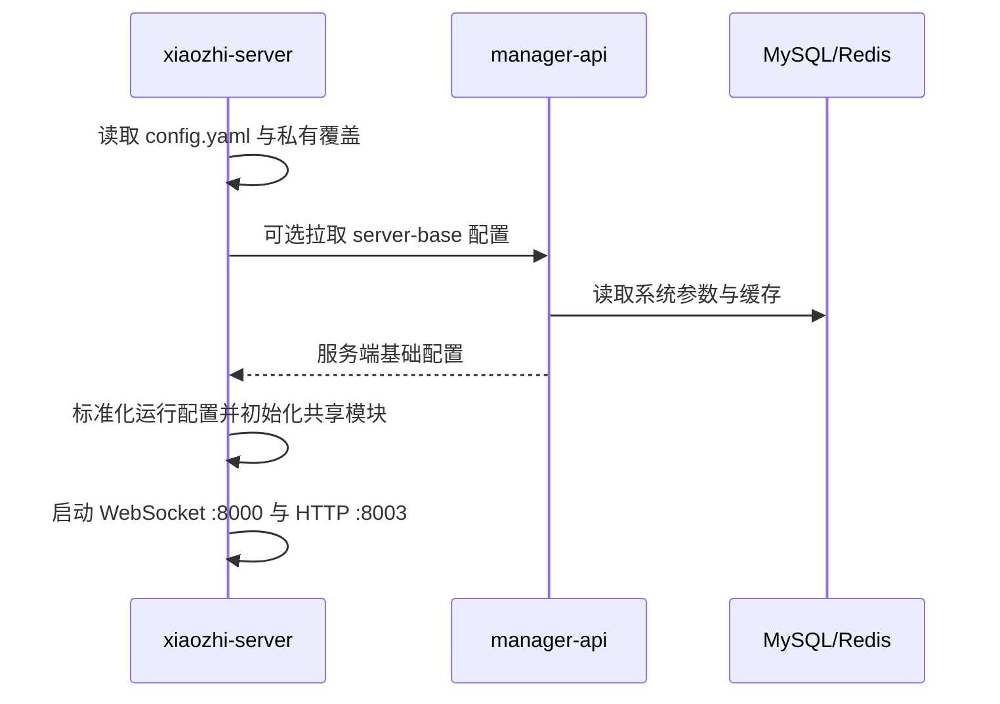
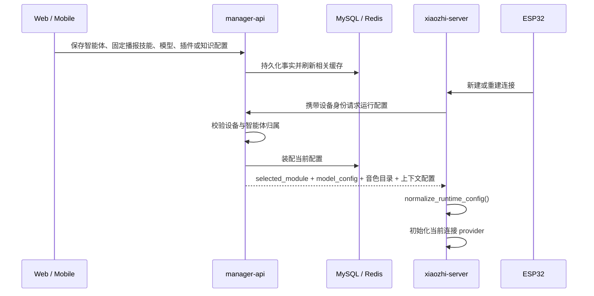
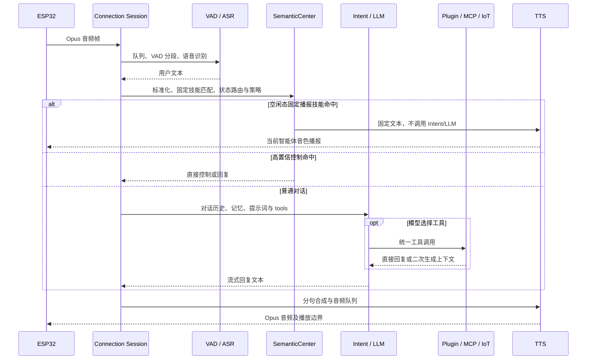

# 运行时链路

本文集中描述跨模块运行时序；provider、MCP、记忆和知识库的内部算法由各领域专题维护。

## 1. 服务启动



`app.py` 确保 `server.auth_key` 有可用值并持久化到私有运行文件。该密钥不能写入文档或提交到 Git。

## 2. 设备启动与连接

```text
设备读取 OTA 入口
-> 请求 OTA / 获取 WebSocket 地址和 Token
-> 连接 /xiaozhi/v1/
-> 默认执行 Token 校验，显式白名单可旁路
-> hello 上报 device-id、client-id 和 features
-> 创建独立 ConnectionHandler
-> 按设备身份从 manager-api 拉取私有配置
-> 初始化连接级模型、记忆、Intent、插件和 MCP
```

设备能力只是一种输入。Device IoT 与 Device MCP 工具仍须经过服务端门控、注册优先级和冲突处理。

## 3. 配置从后台进入会话



智能体运行配置支持在线热更新。保存智能体音色、提示词、模型选择、模型参数、插件、替换词、上下文源、聊天记录模式或固定播报技能后，manager-api 在事务提交后通过受保护的 `/device/runtime-config/refresh` 内部接口按 `agentId` 通知 xiaozhi-server。Python 会重新拉取完整私有配置并在空闲轮次边界重建 VAD、ASR、LLM、TTS、Memory、Intent、工具和提示词运行时，设备 WebSocket 保持连接；正在生成或播报的一轮不会被配置更新中途替换。

内部通知失败不回滚已经提交的数据库事实。每个在线连接会在新一轮 `listen/start` 执行有最短间隔的配置指纹检查；网页真实音频使用 `external_tts`，不会产生 `listen/start`，因此也会在接受新的外部 TTS 任务前、连接空闲边界执行同一配置检查。配置未变化时不重建 provider，变化时再执行热替换，随后新任务才读取 `conn.tts` 并进入队列。刷新通知只标记连接待更新，不会在用户录音、ASR 消费或 TTS 播放中途直接拆换线程。热替换初始化失败会尝试恢复旧运行配置并继续保留设备连接；若旧音频工作线程无法在安全时限内退出，则关闭异常连接以避免重复消费者，由设备正常重连恢复。聊天记录关闭时停止接收新上报，但已进入队列的记录仍会排空。

大模型通过 `set_session_voice` 调整音色、语速、音量或音调时，参数只保存在当前连接，不写回 manager-api。当前 TTS 模型不变的配置热更新会把会话 override 重新应用到新 provider；TTS 模型切换时清除旧 override，避免把旧供应商的音色 ID 带到新模型。双向流 provider 在当前轮开始时已经建立上游 session，因此调整从下一轮回复安全生效，不在播放中途拆换音频通道。

排查“保存成功但设备未变化”时依次检查：数据库事实、Redis 缓存、manager-api 内部刷新日志、Python `/device/runtime-config/refresh` 日志、下一轮配置指纹检查和 provider 热替换结果。只有连接协议、设备固件能力或服务端启动级配置变化仍可能需要设备重连或服务重启。

连接初始化按能力发布 `binding_ready / tts_ready / conversation_ready / audio_input_ready`，不能再用一个
完成标志推断所有 provider 和音频通道均可用。通道打开协程必须成功返回后才能设置对应 ready；初始化异常
记录失败原因且不发布 ready。初始化期间的 `listen/detect` 进入连接级有界 TTL 队列，只有对话能力就绪后
才在连接事件循环回放。

## 4. 一轮语音对话



TTS 播放期间，支持 AEC 的设备检测到用户开口后立即停止旧 LLM/TTS 输出，用户音频继续进入 ASR；非 AEC 设备在完整 ASR 到达后停止播报。

固定播报技能支持完整话术包含匹配和关键词组合匹配。关键词组内全部关键词必须出现、顺序不限，不同规则之间为 OR；冲突按优先级、命中关键词数量、关键词总长度、完整话术优先、排序和技能 ID 稳定决胜。技能只在空闲状态触发，会议、声纹采集、通话和游戏状态保持各自既有优先级。技能问答进入聊天记录但跳过长期记忆事件。

回复轮次由 generation 级 `ReplyLifecycle` 管理。STT 显示本身不创建回复；只有确认本轮会产生语音时才发送
`tts/start`。LLM 任务、工具或 TTS 异常统一终止当前 generation，清理队列并尽力发送 `tts/stop`；正常
LAST、Abort 或连接关闭负责其他终态，因此 `client_is_speaking` 只是活跃生命周期的派生视图。

## 5. 工具发现与执行

注册优先级固定为：Server Plugin、Server MCP、Device IoT、Device MCP、MCP Endpoint。同名工具由先注册者保留，后注册者跳过并记录 warning。

```text
工具源 -> ToolDefinition -> UnifiedToolHandler
-> function_call / intent_llm / 语义控制直接调用
-> ToolManager 路由到对应 executor
-> Action.RESPONSE 直接进入 TTS
   或 Action.REQLLM 回注上下文后再次请求 LLM
```

完整实现见 [功能插件](./function-plugin-architecture.md) 和 [MCP 链路](./mcp-chains.md)。

`reset_conversation_context` 成功后只保留当前 system prompt，并重新注入必要工具 few-shot；工具确认语成为新上下文的第一条 assistant 消息。会议、通话和声纹采集属于受保护状态，不能通过该工具破坏正在执行的事务状态。

## 6. 记忆与知识库

- 记忆：Python 上报对话事件，Java 维护事实、候选与审计；下一轮查询结果注入 LLM 上下文。
- 知识库：Web 上传文件，Java 解析、分块和检索；Python 工具调用检索 API，再把结果交给 LLM。
- 两条链路都必须受 agent、device、dataset 和 workspace 作用域限制；超时或外部模型失败不得关闭主 WebSocket。

## 7. 会话关闭

关闭顺序应覆盖：取消后台任务、停止报告线程、清空 ASR/TTS 队列、关闭工具与 MCP 客户端、释放 provider、注销设备连接映射、关闭 WebSocket。旧连接晚关闭时不能删除已由新连接替换的注册表记录。
