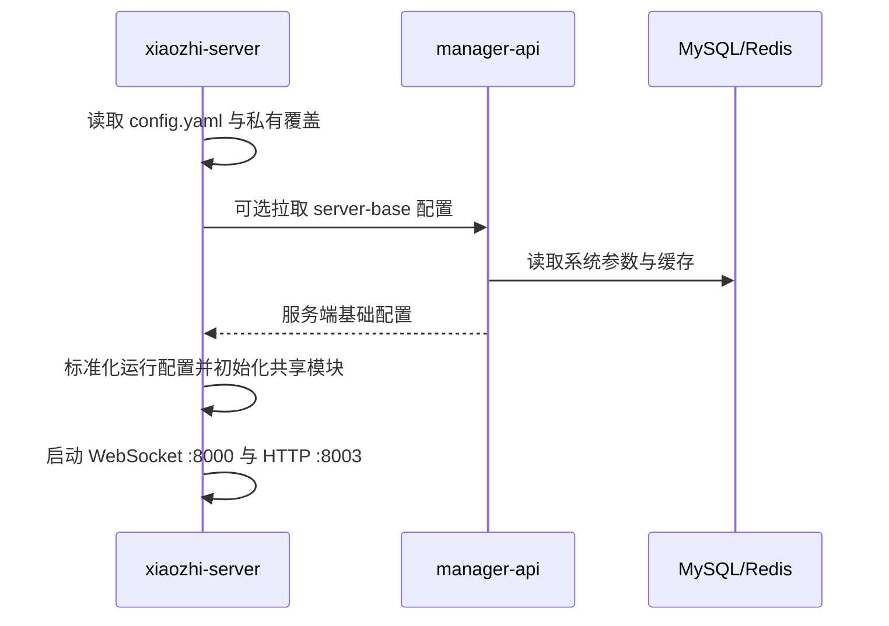
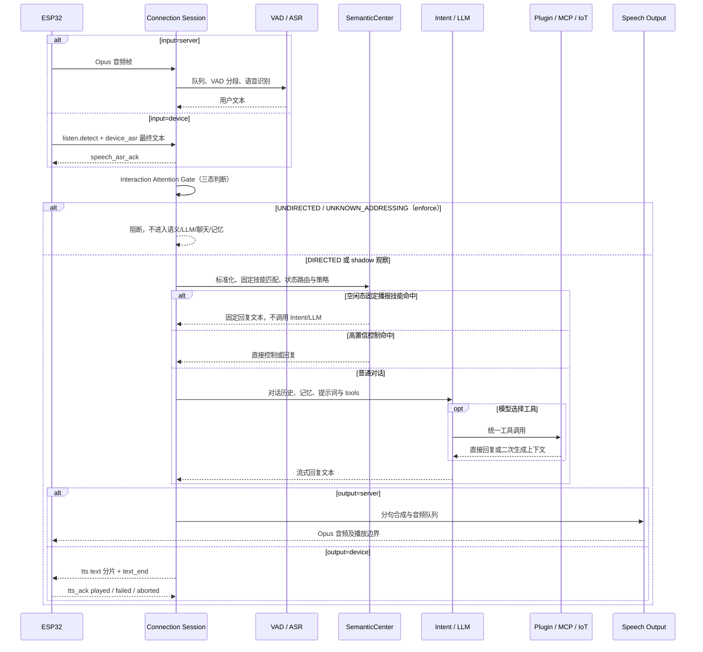
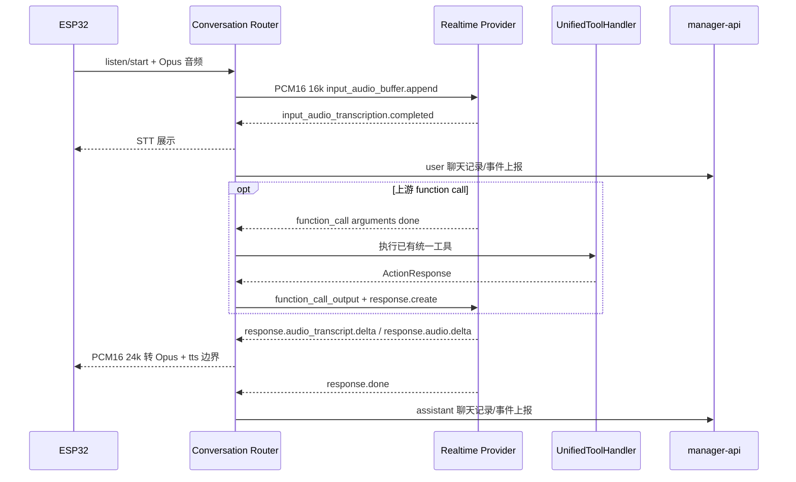

# 运行时链路

本文集中描述跨模块运行时序；provider、MCP、记忆和知识库的内部算法由各领域专题维护。

设备在多个智能体场景之间切换时仍复用本链路，只替换当前连接的智能体运行配置；数据事实、失败回滚和会话隔离见[设备多场景管理](device-scene-management.md)。

## 1. 服务启动



`app.py` 确保 `server.auth_key` 有可用值并持久化到私有运行文件。该密钥不能写入文档或提交到 Git。

## 2. 设备启动与连接

```text
设备读取 OTA 入口
-> 请求 OTA / 获取 WebSocket 地址和 Token
-> 连接 /xiaozhi/v1/
-> 默认执行 Token 校验，显式白名单可旁路
-> hello 上报 device-id、client-id 和 features；端侧 ASR/TTS 使用 features.speech 声明能力
-> 创建独立 ConnectionHandler
-> 按设备身份从 manager-api 拉取私有配置
-> 结合 speech_routing 策略与当前 hello 能力发布实际 speech_route
-> 根据所选 LLM conversation_mode 初始化传统拼接或 Realtime 会话
-> 初始化该模式共用的记忆、提示词、插件和 MCP
```

设备能力只是一种输入。Device IoT 与 Device MCP 工具仍须经过服务端门控、注册优先级和冲突处理。

## 3. 配置从后台进入会话


智能体运行配置支持在线热更新。保存智能体音色、提示词、模型选择、模型参数、插件、替换词、上下文源、聊天记录模式或固定播报技能后，manager-api 在事务提交后通过受保护的 `/device/runtime-config/refresh` 内部接口按 `agentId` 通知 xiaozhi-server。Python 会重新拉取完整私有配置并在空闲轮次边界重建会话管线、Memory、Intent、工具和提示词运行时。普通 LLM 重建 VAD、ASR、LLM、TTS；`conversation_mode=realtime` 重建端到端 Realtime 会话而不初始化传统 ASR/TTS。设备 WebSocket 保持连接；正在生成或播报的一轮不会被配置更新中途替换。

设备语音路由是设备级配置。Web/Mobile 保存 `speechInputMode / speechOutputMode` 后，manager-api 在事务提交后按
`deviceId` 发送同一受保护刷新通知；Python 使用当前连接已经协商并冻结的 hello 能力重新解析候选路由，在连接空闲
边界先构造新管线再原子切换。服务端 ASR 切到设备 ASR 时关闭 VAD/ASR 输入管线；服务端 TTS 切到设备 TTS 时以文本
发送 façade 替换厂商 TTS provider。初始化、能力要求或 Realtime 兼容检查失败时恢复旧管线，不在当前半轮混合回退。
固件新增或移除能力不是配置热更新，必须重连并重新 hello。

角色配置中的 `realtimeVoiceId` 是智能体级 Realtime 音色覆盖：manager-api 只在所选 adapter 声明
`sessionVoice` 且音色通过该 adapter 校验时，覆盖当前 LLM `typed_config.voice`。留空继续使用共享模型的默认音色；
它与传统链路的 `ttsVoiceId` 相互独立，也不会修改其他角色共用的模型配置。固定目录和自定义音色 ID 是否可用均由
`RealtimeAdapterCapabilityRegistry` 声明，页面不按千问、豆包厂商名称写死判断。

内部通知失败不回滚已经提交的数据库事实。每个在线连接会在新一轮 `listen/start` 执行有最短间隔的配置指纹检查；网页真实音频使用 `external_tts`，不会产生 `listen/start`，因此也会在接受新的外部 TTS 任务前、连接空闲边界执行同一配置检查。配置未变化时不重建 provider，变化时再执行热替换，随后新任务才读取 `conn.tts` 并进入队列。刷新通知只标记连接待更新，不会在用户录音、ASR 消费或 TTS 播放中途直接拆换线程。热替换初始化失败会尝试恢复旧运行配置并继续保留设备连接；若旧音频工作线程无法在安全时限内退出，则关闭异常连接以避免重复消费者，由设备正常重连恢复。聊天记录关闭时停止接收新上报，但已进入队列的记录仍会排空。

大模型通过 `set_session_voice` 调整音色、语速、音量或音调时，参数只保存在当前连接，不写回 manager-api。当前 TTS 模型不变的配置热更新会把会话 override 重新应用到新 provider；TTS 模型切换时清除旧 override，避免把旧供应商的音色 ID 带到新模型。双向流 provider 在当前轮开始时已经建立上游 session，因此调整从下一轮回复安全生效，不在播放中途拆换音频通道。

排查“保存成功但设备未变化”时依次检查：数据库事实、Redis 缓存、manager-api 内部刷新日志、Python `/device/runtime-config/refresh` 日志、下一轮配置指纹检查和 provider 热替换结果。只有连接协议、设备固件能力或服务端启动级配置变化仍可能需要设备重连或服务重启。

连接初始化按能力发布 `binding_ready / tts_ready / conversation_ready / audio_input_ready`，不能再用一个
完成标志推断所有 provider 和音频通道均可用。通道打开协程必须成功返回后才能设置对应 ready；初始化异常
记录失败原因且不发布 ready。初始化期间的 `listen/detect` 进入连接级有界 TTL 队列，只有对话能力就绪后
才在连接事件循环回放。

Realtime 模式中的 `tts_ready` 表示“实时模型的音频输出到设备链路已就绪”，不表示传统 TTS provider 已初始化；
`audio_input_ready` 表示设备音频可以发送给实时上游。Realtime 建连、鉴权或 `session.update` 失败时不得发布这些 ready，
也不得静默初始化传统链路继续对话。管理员需要修复实时配置或把智能体主 LLM 手动切回普通模型。

## 4. 一轮语音对话的双轨路由

路由只读取 `selected_module.LLM` 对应 `model_config.<id>.typed_config.conversation_mode`：值为 `realtime` 时消费
音频、listen、文本、图片和 abort；其他值保持既有传统链路。厂商名称、model_name 或页面标签不是运行时判断依据。

### 4.1 传统拼接模式

传统模式的语音输入与输出分别解析，支持四种组合：

| 实际输入 | 实际输出 | 运行行为 |
| --- | --- | --- |
| `server` | `server` | 设备上传 Opus；服务端 VAD/ASR、LLM、TTS 后回传 Opus |
| `device` | `server` | 设备上传最终识别文本；服务端从语义/LLM 开始处理并回传 TTS Opus |
| `server` | `device` | 服务端 VAD/ASR 和 LLM；回复文本下发设备，由设备合成并回 ACK |
| `device` | `device` | 设备上传最终识别文本；服务端只处理语义/LLM，设备合成回复并回 ACK |

每一侧的策略为 `server / device / auto`。`server` 强制服务端；`device` 缺能力时初始化失败；`auto` 有能力时选
设备端、否则回退服务端。输出端只有同时声明 `device_tts` 与 playback ACK 才算能力完整。旧固件和缺省数据库值均为
`server/server`，保持现有链路。

能力协商在当前连接 hello 与私有配置到齐后进行。成功时向设备发送 `speech_route`，同时包含实际 `input/output`、
后台 `inputPolicy/outputPolicy` 和 `helloTimedOut`。显式设备策略无法满足时发送
`speech_route status=error, reason=incompatible_route`，且不发布会话 ready。



交互注意力采用无音区 MVP，不要求设备提供主驾、副驾或后排位置。明确唤醒或按键、连接级交互状态、上一轮问答、
时间间隔、当前 ASR 文本和 ASR 置信度共同形成判断证据。默认参数为：首轮 `armed_window_ms=8000`、普通跟进
`follow_up_window_ms=6000`、明确提问后的回答 `awaiting_reply_window_ms=12000`、放行阈值 `0.88`、背景语音阈值
`0.30`、ASR 置信度下限 `0.20`，打断策略为 `balanced`。

输出固定为 `DIRECTED / UNDIRECTED / UNKNOWN_ADDRESSING`。`mode=shadow` 是安全默认值，只记录如果启用门控时的
决策，不改变当前语义、LLM、聊天记录、长期记忆或打断行为。运行时门控位于 `startToChat()` 中，强制模式下只有
`DIRECTED` 可以继续；设备可通过 `listen.start/listen.detect` 的 `interaction` 字段提供显式触发、ASR 置信度和
可选 DDSD 分数。
后续启用 `enforce` 后，`UNDIRECTED` 与 `UNKNOWN_ADDRESSING` 必须在创建回复生命周期前结束；模型超时、异常、
无结果或非法结果按 `UNKNOWN_ADDRESSING` 失败关闭。即使判断为 `DIRECTED`，高风险车控也仍需通过独立权限和安全校验。

设备 ASR 消息必须使用 `listen.detect + source=device_asr + final=true + turn_id + text`。服务端在进入语义/LLM 前按
`turn_id` 幂等并限流，然后对接受、重复或拒绝都返回 `speech_asr_ack`；设备识别正文只以长度占位进入协议日志。
初始化期间仍按 readiness 队列延迟，但设备 ASR 使用 `turn_id` 去重，避免不同文本重试绕过幂等。

设备 TTS 继续复用 generation 级 `ReplyLifecycle` 和既有 `tts/start`。每个 `tts state=text` 带
`sentence_id / generation / sequence`，`text_end` 表示本句文本发送完毕，不表示扬声器播放完成。设备必须在物理播放
完成后回 `tts_ack event=played`；合成或播放失败回 `failed`，因设备侧取消回 `aborted`。只有 `played` 正常完成回复，
其他事件和 ACK 超时均失败或中断并发送一次 stop；迟到旧 generation ACK 被忽略，且不得触发服务端 TTS 半轮回退。
当前端侧输出只支持文本，音乐等 `ContentType.FILE` 不通过该契约传给设备合成。

TTS 播放期间，支持 AEC 的设备在服务端声学门控确认用户开口后立即停止旧 LLM/TTS 输出，用户音频继续进入 ASR；声学门控在 Silero 概率后结合 RMS、自适应噪声底、SNR 和多帧状态机，使用严格开始、宽松继续及有界尾帧，并通过 pre-roll 保留确认前首音。`shadow` 只记录决策，`enforce` 才改变 Abort 与分段；非 AEC 设备仍在完整 ASR 到达后停止播报。

固定播报技能支持完整话术包含匹配和关键词组合匹配。关键词组内全部关键词必须出现、顺序不限，不同规则之间为 OR；冲突按优先级、命中关键词数量、关键词总长度、完整话术优先、排序和技能 ID 稳定决胜。技能只在空闲状态触发，会议、声纹采集、通话和游戏状态保持各自既有优先级。技能问答进入聊天记录但跳过长期记忆事件。

回复轮次由 generation 级 `ReplyLifecycle` 管理。STT 显示本身不创建回复；只有确认本轮会产生语音时才发送
`tts/start`。LLM 请求或响应流异常若已排入错误提示语音，任务必须返回已处理，由同一 generation 的
TTS LAST 正常收尾，不能被任务回调当作“无语音结果”提前清空。排队前必须检查打断和 generation，
旧任务不得向新回复注入错误提示；该逻辑由 `core/handle/llmErrorHandle.py` 统一承担。
未能安排兜底的 LLM 任务异常、工具或 TTS 异常终止当前 generation，清理队列并尽力发送 `tts/stop`；正常
LAST、Abort 或连接关闭负责其他终态，因此 `client_is_speaking` 只是活跃生命周期的派生视图。

### 4.2 端到端 Realtime 模式

Realtime adapter 已整体接管音频输入和输出，不能再与设备 ASR 或设备 TTS 拆分组合。只要语音策略与 hello 能力解析后的
实际路由任一侧为 `device`，初始化就以 `incompatible_route` 失败，不把当前半轮转成传统链路。对声明端侧语音能力的
设备使用 Realtime 智能体时，管理员必须把输入和输出策略都明确设为 `server`；`auto` 会优先选设备能力，因此不能用来
表达 Realtime 的服务端直通。这里的 `server` 表示“不启用设备端拆分”，实际音频仍由 Realtime adapter 端到端处理，
并不初始化传统 ASR/TTS provider。



运行边界：

- 输入使用设备 Opus 解码为 PCM16 16 kHz 单声道；输出 PCM16 24 kHz 单声道编码为设备 Opus。采样率来自受支持 adapter 的固定契约或受校验配置，不能任意互换。
- server VAD 模式持续 append，由上游判停；manual 模式在 `listen/stop` 执行 commit 和 `response.create`。同一轮不得重复 commit。
- 上游输入转写完成后才写 user 对话和聊天记录；回复文本增量同时用于 Realtime 字幕预览，但不提前形成 assistant 记录。首片音频发送时若已有文本，先发一次 `tts/sentence_start` 预览；完整文本事件或 `response.done` 在 `tts/stop` 前再次发送完整回答，避免旧固件永久停留在首字。`response.done` 或错误终态负责一次性写 assistant 记录并结束设备 TTS 状态。
- Abort 发送 `response.cancel` 和输入缓冲清理，停止当前设备音频并使回复生命周期只收敛一次；迟到旧事件不得结束新回复。
- 对支持 Function Calling 的 Realtime adapter（当前 Qwen），上游只负责提出调用。会话初始化会按 adapter 能力确保
  `UnifiedToolHandler` 已就绪，不依赖传统 Intent provider 是否存在，因此 `Intent_nointent` 不会再导致 Realtime 工具列表为空。
  工具清单仍来自统一注册表，执行仍走本地门控和 executor；工具结果以 `function_call_output` 回注，随后显式创建后续响应。
  豆包当前协议没有本地工具结果回注契约，因此不向上游暴露工具。

### 4.3 图片入口

传统模式继续由独立 VLLM 处理视觉 HTTP 请求。Realtime 模式下，视觉入口先按认证信息和设备绑定找到活动连接，再按
adapter 能力处理；Qwen 3.5 图片必须是 Base64 后不超过 256 KiB 的 JPG/JPEG，并在图片前先发送非空 PCM，随后与音频缓冲区一起提交。豆包端到端当前不支持图片，必须明确返回错误。文本结果保持原 HTTP JSON 契约，回复音频可同时从设备 WebSocket 播放。

没有活动 Realtime 连接时保持原有传统 VLLM 图片链路。活动连接已经选择 Realtime 时，则必须把图片交给该会话；若其实时
session 未就绪、图片超限/格式不支持、上游响应超时或连接已关闭，应明确失败，不自动改调独立 VLLM 伪装成功。任何模式
都不允许用请求中的 deviceId 绕过 Token 与设备身份校验。图片正文、base64 和上游凭据不得写入普通日志。

## 5. 工具发现与执行

注册优先级固定为：Server Plugin、Server MCP、Device IoT、Device MCP、MCP Endpoint。同名工具由先注册者保留，后注册者跳过并记录 warning。

```text
工具源 -> ToolDefinition -> UnifiedToolHandler
-> function_call / intent_llm / 语义控制直接调用
-> ToolManager 路由到对应 executor
-> Action.RESPONSE 直接进入 TTS
   或 Action.REQLLM 回注上下文后再次请求 LLM
```

完整实现见 [功能插件](./function-plugin-architecture.md) 和 [MCP 链路](./mcp-chains.md)。

`reset_conversation_context` 成功后只保留当前 system prompt，并重新注入必要工具 few-shot；工具确认语成为新上下文的第一条 assistant 消息。会议、通话和声纹采集属于受保护状态，不能通过该工具破坏正在执行的事务状态。

不支持原生工具回注的 Realtime adapter 仍可由管理员手动清空。设备管理页按设备记录调用
`POST /device/{id}/conversation-context/reset`；manager-api 先校验 Workspace 写权限，从数据库绑定关系派生
`deviceId + agentId`，再用服务密钥调用 Python 的 `/device/session/context/reset`。Python 二次校验在线连接与
agent 绑定，并只在设备空闲时清理本地短期状态；Realtime 模式同时按 adapter 能力重建上游 session。该操作
不删除聊天记录、长期记忆或共享模型配置，设备离线、正在收音/播报、会议、通话或声纹采集时明确拒绝。

支持工具的 Realtime provider 保留厂商当前协议要求的 OpenAI 风格嵌套 `function` schema，来源、优先级、参数 JSON Schema 和执行器不变。转换不能扩张工具白名单。设备 IoT/MCP 描述仍不能绕过服务端显式门控；不支持工具回注的 adapter 不得把工具描述发送给上游。

## 6. 记忆与知识库

- 记忆：Python 上报对话事件，Java 维护事实、候选与审计；下一轮查询结果注入 LLM 上下文。
- 知识库：Web 上传原始文件，Java 持久化原件、解析分块并维护本机 Lucene 派生索引；Python 把用户原问和模型改写问句一并交给检索 API，再把结果交给 LLM。工具关闭的递归轮也必须拦截原始或 HTML 转义的 DSML 工具协议，不能送入字幕或 TTS。
- 两条链路都必须受 agent、device、dataset 和 workspace 作用域限制；超时或外部模型失败不得关闭主 WebSocket。
- Realtime 主模型是长连接会话 provider，不等价于可供后台同步调用的文本 LLM。会话建立时可以把已有 `summaryMemory` 作为静态 instructions 注入，输入/回复事件也可继续上报；但它不走传统 `Connection.chat()` 的逐轮 `_query_memory_context`。server VAD 自动响应模式下，基于每轮 query 的托管动态召回暂不等同于传统链路。依赖普通文本 LLM 的短期总结、知识库切片、Judge、主动记忆整理等附属任务必须引用独立且测试通过的传统 LLM/SLM，或选择托管/仅上报模式；不能默认复用实时连接。

## 7. 状态、错误和回退

| 场景 | 对外行为 | 回退边界 |
| --- | --- | --- |
| 显式 `device` 策略但 hello 未声明对应能力 | 下发 `speech_route status=error`，能力保持未就绪 | 不静默改用服务端 provider |
| `auto` 策略且能力缺失或设备 TTS 无 playback ACK | 该侧实际路由解析为 `server` 并发布 `speech_route` | 只在初始化时完整回退，不在半轮重放输入或回复 |
| 设备 ASR 重复、超长、非法或触发限流 | 返回 `speech_asr_ack accepted=false` 和稳定原因 | 不进入语义、Intent 或 LLM |
| 设备 TTS 返回 failed/aborted 或 ACK 超时 | 当前 generation 失败/中断并发送一次 stop | 不把文本改送服务端 TTS，不伪造播放完成 |
| Realtime 解析到任一设备端语音路由 | 下发不兼容错误且不发布会话 ready | 不混用 Realtime 与设备 ASR/TTS |
| Realtime 建连/鉴权/session.update 失败 | 对话能力保持未就绪并记录脱敏错误 | 不自动创建传统 ASR/LLM/TTS |
| 当前响应超时、协议错误或上游断开 | 取消当前回复、发送一次 stop、关闭或重建上游会话 | 不把半轮音频重新送入传统链路 |
| 工具执行失败 | 结构化错误回注 Realtime 模型，由模型生成用户可读回复 | 不跳过工具权限或伪造成功结果 |
| 用户在播报中开口 | adapter 使用上游语音开始/ASR 开始事件取消当前响应，本地立即发送无等待 stop，并保留新用户音频 | 不清空打断语句的输入缓冲；设备仍需 AEC 和持续上行 |
| 交互注意力判断为背景或不确定（enforce） | 结束当前输入轮次，不创建回复、不写聊天或记忆 | 不进入 SemanticCenter、Intent、LLM 或工具；判断异常按 `UNKNOWN_ADDRESSING` 失败关闭 |
| 清空短期上下文 | 当前确认回复结束后重建上游 Realtime session，再恢复 system prompt、工具和当前会话音色 | 不删除后台聊天记录或长期记忆，不在旧上游 session 中假装已清空 |
| 运行中切换音色 | 由 adapter 能力应用到下一轮；Qwen 更新 session，豆包重建 session | 不改写 manager-api 保存的共享模型配置 |
| 已选 Realtime 但会话未就绪 | HTTP 明确失败 | 不按任意 deviceId 新建会话，不静默转 VLLM；非 Realtime 请求仍走传统 VLLM |
| 管理员切回普通 LLM | 下一安全轮次热更新为传统管线 | 保留原 VAD/ASR/TTS/VLLM 配置并重新启用 |

错误日志只记录模型配置 ID、adapter、路由、事件类型、状态码、turn/sentence 标识、正文长度和脱敏原因，不记录
Authorization、API Key、设备 ASR/TTS 正文、完整音频、图片 base64、工具敏感参数或整份上游事件。上游 URL 必须为
`wss://` 且通过 adapter 端点白名单/SSRF 校验。

## 8. 会话关闭

关闭顺序应覆盖：取消后台任务、停止报告线程、取消 Realtime 响应并关闭上游 WebSocket、清空 ASR/TTS 或实时音频缓冲、
关闭工具与 MCP 客户端、释放 provider、注销设备连接映射、关闭设备 WebSocket。旧连接晚关闭时不能删除已由新连接替换的
注册表记录；关闭中的上游迟到事件不能再次发送音频或 stop。

## 9. 自动测试链路

| 层 | 必须覆盖 |
| --- | --- |
| 设备语音路由 | 旧固件 `server/server`；四种传统组合；`server/device/auto`；hello 超时；显式能力缺失；device TTS 缺 playback ACK；Realtime 冲突 |
| 设备 ASR | final/source/turn_id/text 校验、幂等、限流、初始化延迟回放、单轮 context、正文日志脱敏和 `speech_asr_ack` |
| 设备 TTS | text 顺序、text_end、played/failed/aborted、ACK 超时、Abort、迟到 generation、文件拒绝、聊天记录与 external_tts 终态 |
| 会话路由 | 普通 LLM 保持传统路径；`conversation_mode=realtime` 消费音频/listen/text/image/abort；未知模式安全回到传统路径 |
| Realtime transport | 建连 header 脱敏、session.update、事件大小上限、正常/错误/超时/关闭、文本 benchmark |
| 音频 | Opus -> PCM16 16k、PCM16 24k -> Opus、尾帧冲刷、乱序/迟到事件、取消后不串轮 |
| 工具 | 按 adapter 能力启用；Qwen 覆盖 schema 转换、统一门控、function_call 参数增量、结果回注、失败结果和二次 response.create；无回注协议的 adapter 必须明确拒绝 |
| 图片 | 活动连接与归属、Realtime/传统分流、大小/格式限制、超时和连接关闭 |
| 生命周期 | readiness、回复 start/stop 幂等、显式 Abort、自然打断不丢新音频、上下文重建、会话音色切换、热更新切换模式、连接关闭资源释放 |
| 控制面/Web | Realtime 目录可选择且需真实测试；模型与智能体页面显示模式标签、绕过项、手动切回和记忆边界 |

自动测试使用 fake Realtime WebSocket 和固定 PCM/图片样本，不调用真实外部模型。合入前统一运行 Python Conda 测试、Java
`mvn test`、Web `npm run test:unit && npm run build`；真实凭据端到端验收属于发布前受控验证，失败时不得伪造通过。
