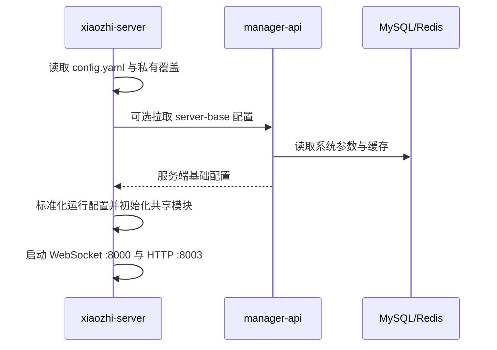
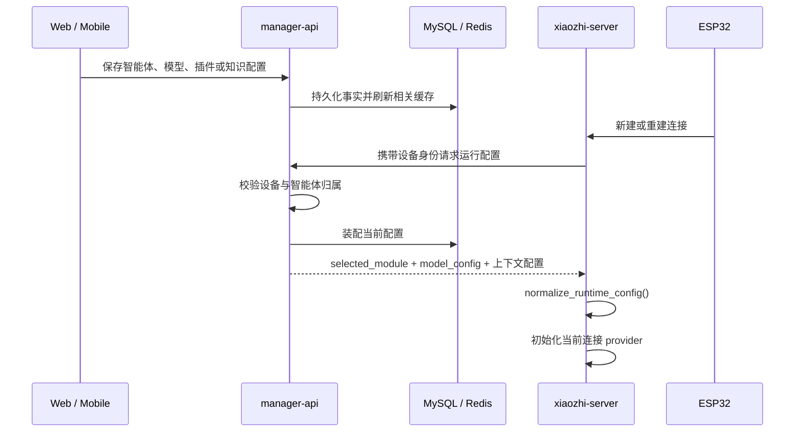
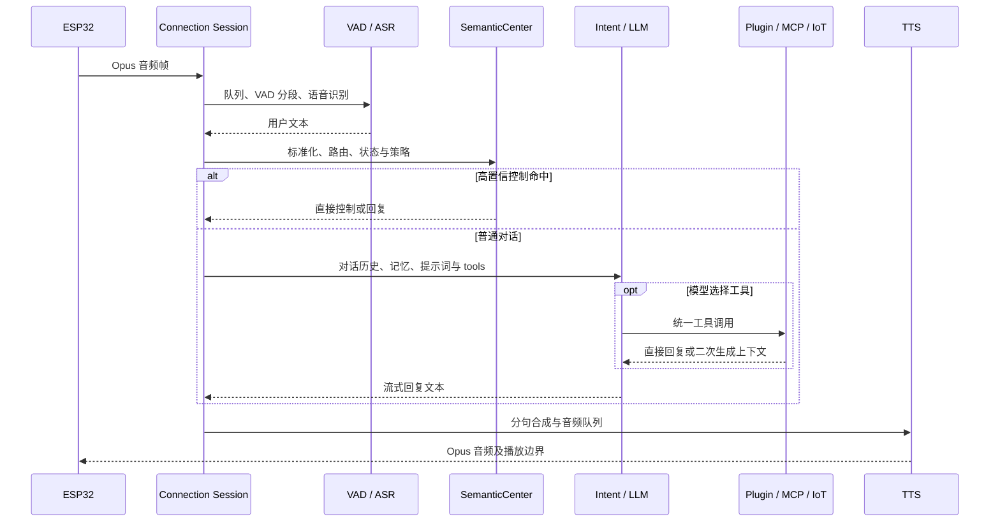

# 运行时链路

本文集中描述跨模块运行时序；provider、MCP、记忆和知识库的内部算法由各领域专题维护。

## 1. 服务启动



`app.py` 确保 `server.auth_key` 有可用值并持久化到私有运行文件。该密钥不能写入文档或提交到 Git。

## 2. 设备启动与连接

```text
设备读取 OTA 入口
-> 请求 OTA / 获取 WebSocket 地址和 Token
-> 连接 /xiaozhi/v1/
-> 默认执行 Token 校验，显式白名单可旁路
-> hello 上报 device-id、client-id 和 features
-> 创建独立 ConnectionHandler
-> 按设备身份从 manager-api 拉取私有配置
-> 初始化连接级模型、记忆、Intent、插件和 MCP
```

设备能力只是一种输入。Device IoT 与 Device MCP 工具仍须经过服务端门控、注册优先级和冲突处理。

## 3. 配置从后台进入会话



当前会话是否热更新取决于具体配置类型。排查“保存成功但设备未变化”时依次检查：数据库事实、Redis 缓存、设备绑定、Python 拉取结果、连接是否重建、provider 是否使用了新配置。

## 4. 一轮语音对话



TTS 播放期间，支持 AEC 的设备检测到用户开口后立即停止旧 LLM/TTS 输出，用户音频继续进入 ASR；非 AEC 设备在完整 ASR 到达后停止播报。

## 5. 工具发现与执行

注册优先级固定为：Server Plugin、Server MCP、Device IoT、Device MCP、MCP Endpoint。同名工具由先注册者保留，后注册者跳过并记录 warning。

```text
工具源 -> ToolDefinition -> UnifiedToolHandler
-> function_call / intent_llm / 语义控制直接调用
-> ToolManager 路由到对应 executor
-> Action.RESPONSE 直接进入 TTS
   或 Action.REQLLM 回注上下文后再次请求 LLM
```

完整实现见 [功能插件](./function-plugin-architecture.md) 和 [MCP 链路](./mcp-chains.md)。

## 6. 记忆与知识库

- 记忆：Python 上报对话事件，Java 维护事实、候选与审计；下一轮查询结果注入 LLM 上下文。
- 知识库：Web 上传文件，Java 解析、分块和检索；Python 工具调用检索 API，再把结果交给 LLM。
- 两条链路都必须受 agent、device、dataset 和 workspace 作用域限制；超时或外部模型失败不得关闭主 WebSocket。

## 7. 会话关闭

关闭顺序应覆盖：取消后台任务、停止报告线程、清空 ASR/TTS 队列、关闭工具与 MCP 客户端、释放 provider、注销设备连接映射、关闭 WebSocket。旧连接晚关闭时不能删除已由新连接替换的注册表记录。
