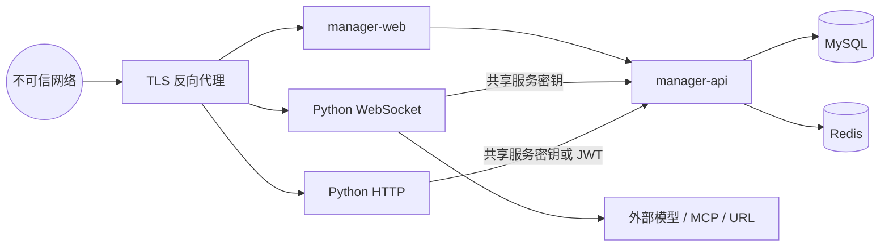

# 安全架构

本文描述系统的信任边界和强制控制。具体编码要求以 `AGENTS.md` 和安全相关源码为准。

## 1. 信任边界

设备、浏览器输入、上传文件、外部 URL、模型输出和 MCP 工具结果均视为不可信。内部网络不等于自动可信；共享密钥只能提供服务身份，不能替代资源归属校验。

## 2. 认证入口

| 入口 | 默认机制 | 例外 |
| --- | --- | --- |
| Python WebSocket | `auth.enabled=true`，验证 Bearer Token | `allowed_devices` 显式白名单 |
| Python 视觉接口 | JWT Bearer Token | 无隐式匿名 |
| Python Device MCP HTTP | 原始 `auth_key` 或 manager-api 密钥 | 仅受信内部调用 |
| Java 管理 API | Shiro OAuth2 Filter | `ShiroConfig` 显式 `anon` 路径 |
| Java `/config/**` | `ServerSecretFilter` | OPTIONS 预检 |
| OTA | 匿名 | 必须限流、校验文件名和下载路径 |

新增端点必须在对应过滤器或路由中明确身份策略，不能依赖模糊默认值。

管理端登录采用多会话 Token：同一账号可在多个浏览器、网页和移动设备同时登录。每个登录会话使用独立 Token；普通退出只注销当前 Token，修改密码或找回密码注销该账号全部 Token。过期会话在该用户下次登录时清理，任何日志都不得输出原始 Token。

用户会话使用 `USER` audience，员工使用独立员工表和 `OPS` 会话、TOTP 与服务端登录限流。员工没有租户用户 ID，用户令牌不能用于运营接口，运营令牌不能用于用户私有内容接口；服务间身份仅在受保护的内部请求中生效。首次员工初始化是本地一次性操作，不根据“第一位用户”或旧管理员身份自动授予权限，详见[平台服务与运营隔离](platform-service-and-operations.md)。

## 3. 授权

- Java CRUD 必须使用实体实际的 `workspace_id`、`agent_id` 或 `device_id` 验证资源所有权。
- `X-Workspace-Id`、请求体中的 agent/device/workspace 标识不能直接作为授权结论。
- `/config/**` 即使通过共享服务密钥，也必须按设备绑定和智能体归属限制返回数据。
- Controller 的权限注解、Shiro 路由和应用服务的资源校验承担不同职责，不能互相替代。
- MEMBER 等只读角色的写限制必须在服务端执行，前端隐藏按钮只改善交互。
- 无超级管理员、通配角色或员工跨租户内容旁路；岗位以固定权限目录和范围授权。官方资源维护权不能从“属于某管理员的团队”继承。
- 运营端不能返回用户密码或创建冒用用户的会话；员工治理、公共资源维护、平台额度与供应商财务分别授权。

## 4. 密钥与日志

- 可提交配置只能包含占位符；真实密钥进入私有配置、环境变量或专用密钥表。
- 禁止把 API Key 放入 URL query；使用 Header 或请求体中的受保护字段。
- 日志不得输出 Authorization、Bearer Token、API Key、access token、secret/private key 或完整私有配置。
- 可记录 `tokenPresent`、凭据类型、脱敏尾号、错误分类和请求关联 ID。
- 公共模型目录和 Redis 配置不包含用户原始供应商凭据。密钥由每次受限执行许可在可信服务内解析，不进入客户端、日志或补传队列。

## 5. 输入与外联

- 用户提供的 MCP、RAG、天气、新闻或 HTTP 工具 URL 必须执行 SSRF 校验，阻止回环、私网、链路本地和云元数据地址。
- 文件上传同时校验扩展名、MIME、大小和业务允许类型。
- 文件读取与下载使用规范化真实路径并确认仍位于允许根目录。
- 模型和 MCP 返回的文本、JSON、工具名和 schema 在使用前必须校验类型和大小。
- no-code HTTP 工具属于高风险能力，只能开放给可信运营人员并限制目标网络。

## 6. 传输与容器

- 生产必须由反向代理提供 HTTPS/WSS；设备配置下发 `wss://` 和公网可达的 `https://` 地址。
- MySQL、Redis 和内部 manager-api 地址只在容器网络或受控主机网络可达。
- 数据库和 Redis 密码不得有生产默认值；容器使用非 root、`cap_drop: ALL` 和最小 `cap_add`。
- Docker 镜像、MCP npm 包和 Python/Java 依赖应锁定版本并进入供应链审查。

## 7. 安全变更检查

安全相关变更至少验证：匿名路由清单、Token 失败路径、跨 workspace/agent 访问、日志脱敏、SSRF 私网阻断、上传路径穿越、共享密钥覆盖范围，以及 Python 核心中是否有裸 `except:` 吞掉安全异常。
