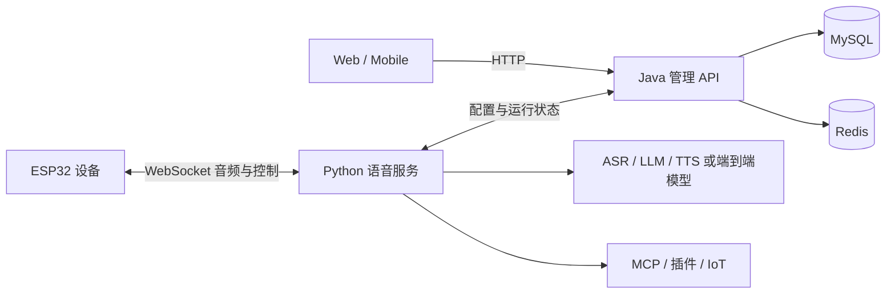

# 项目交接与共同维护指南

面向新加入的维护同事：完成权限交接、在本地跑通项目、理解关键功能边界，再通过评审共同发布。本文是交接操作入口；架构以[项目架构总览](../architecture/project-architecture.md)为准，开发与发布规则分别以[开发规范](../standards/development-specification.md)和[生产部署文档](../deployment/private-docker-release.md)为准。

## 1. 交接基线与使用方式

本项目是深度定制的 `xiaozhi-esp32-server`，不能直接照官方原仓库覆盖配置、迁移或部署脚本。

2026-10-10 整理时，本地已提交代码为 `7eb199a5`，所在分支为 `feature/add-conversation-latency-export`。分支名属于历史工作分支，不代表所有代码仅涉及延迟导出，也不代表已合入 `main`。接手时先由两人确认集成分支，再开始开发。

最近一次本次交接工作记录中的生产验收发生在 **2026-10-08**：版本 `7eb199a5-lite`，管理 API、Web、语音服务健康，页面返回成功，数据库已备份。**本文编写时未重新检查生产服务器，这不是 10 月 10 日线上版本的证明。** 发布前必须重新读取容器镜像标签、健康状态与部署记录。

代码基线之外仍可能有未提交工作。此次整理时存在移动端 manifest 配置修改和首页背景图删除，未纳入交接基线、未修改或提交；接手前应由对应开发者确认归属和去向。不要复制整个脏工作目录作为交接包。

推荐阅读顺序：本文 → [本地开发](local-dev-workflow.md) → [架构总览](../architecture/project-architecture.md) → 自己负责模块的 README。使用 AI 工具时首先阅读根目录 [AGENTS.md](../../AGENTS.md)。

## 2. 项目组成与数据流

| 模块 | 技术栈与职责 | 开发入口 |
| --- | --- | --- |
| `main/xiaozhi-server` | Python 3.10；设备连接、语音处理、Realtime、工具调用、运行时热更新 | [本地开发](local-dev-workflow.md) |
| `main/manager-api` | Java 21 / Spring Boot；权限、工作空间、配置下发、设备、模型、知识库、记忆和数据库迁移 | [管理 API](../../main/manager-api/README.md) |
| `main/manager-web` | Vue 2 / Element UI；PC 智控台 | [Web](../../main/manager-web/README.md) |
| `main/manager-mobile` | Vue 3 / uni-app / TypeScript；H5、App、微信端 | [移动端](../../main/manager-mobile/README.md) |
| `main/maintenance-agent` | 维护工作台相关服务；是否构建和部署需单独核对 | [模块总览](../../main/README.md) |
| `scripts`、`deploy` | 本地开发入口、镜像发布、生产升级资产 | [脚本](../../scripts/README.md)、[部署资产](../../deploy/README.md) |



传统对话链路为 VAD → ASR → 语义处理 → LLM → TTS；端到端模型通过独立 Realtime adapter 接管音频输入和输出。不要把端到端模型当作普通 OpenAI Compatible 文本模型配置。

常用生产对外端口为设备 WebSocket `8000`、Python HTTP/OTA `8003`、管理入口 `8002`。本地 Web 开发服务器通常使用 `8001`；容器内 Java 端口及反向代理关系以生产 Compose 为准，不能仅凭宿主端口判断容器间地址。生产使用 HTTPS/WSS。

## 3. 权限与资产交接清单

由当前维护者通过团队认可的安全渠道完成下表，不在本文、聊天记录或 Git 中填入密码和密钥。

| 资产 | 需要交接的内容 | 接手完成标志 |
| --- | --- | --- |
| 私有 Git | 仓库地址、成员权限、集成分支、PR 规则；每人使用自己的 SSH Key | 能 clone、推送个人分支、发起评审 |
| 开发数据库与 Redis | 独立开发实例、账号、初始化方式、脱敏测试数据 | 本地 API 能启动，Liquibase 正常完成 |
| 模型与语音服务 | 服务商项目、已开通模型/音色、额度、测试凭据保管位置 | 在隔离环境完成约定的小额测试 |
| ACR 镜像仓库 | 命名空间、构建机与服务器各自的登录权限 | 能推送测试标签、服务器能拉取 |
| 生产 SSH | 主机/别名、正确登录用户、个人公钥、sudo 范围 | 能只读查看容器状态和必要日志 |
| 域名、TLS、Nginx | 管理平台权限、证书续期方式、配置路径 | 能确认访问链路与证书有效期 |
| 数据与备份 | 数据目录、备份位置、权限、保留周期、恢复负责人 | 两人能找到备份，并在隔离库演练恢复 |
| 设备与移动端 | 测试设备、固件来源、OTA 地址、App/小程序账号及签名材料保管位置 | 能完成一次绑定和对话验收 |
| 责任人 | 各模块主维护者、复核人、发布人、故障联系人 | 双方明确实际姓名与联系渠道 |

不要通过共享生产管理员账号代替个人权限交接。第三方模型真实调用和音色复刻可能计费，应约定测试项目和额度。生产数据库备份不得作为普通开发数据直接分发。

## 4. 同事首次拉取与本地启动

先从维护者取得私有仓库地址和确认后的集成分支，在自己的目录 clone。不要默认以官方仓库作为 `origin`。

```bash
# 在仓库根目录检查
 git status --short --branch
 git remote -v
 git log -5 --oneline
```

`origin` 为团队私有仓库，允许推送；`upstream` 为官方仓库，只用于 fetch/diff/sync，禁止推送。

环境安装按[本地开发工作流](local-dev-workflow.md)执行：JDK 21、Maven、Node.js 22 LTS、npm、pnpm、Conda、MySQL、Redis，以及语音处理所需系统库。依赖版本以各模块声明和 lockfile 为准。

Python 必须使用名为 `xiaozhi-esp32-server` 的 Conda 环境。私有配置按本地教程准备，确认 `manager-api.url` 指向开发 API，服务共享密钥一致；不要误连生产数据库或生产语音服务。

```bash
scripts/dev doctor
scripts/dev start api
scripts/dev start web
scripts/dev start server
# 需要调试移动端时再启动
scripts/dev start mobile
scripts/dev status
scripts/dev logs api
# 完成后停止本地服务
scripts/dev stop
```

依赖启动顺序：MySQL/Redis → 管理 API → Web/语音服务 → 按需启动 Mobile。`scripts/dev doctor` 是环境体检，不等于真实模型或设备验收。

首次验收建议：登录开发后台 → 创建测试智能体 → 配置测试通过的模型 → 绑定测试设备 → 完成一次语音对话 → 确认日志和后台记录 → 修改一项配置并复验。不要首次上手就用生产设备作为调试对象。

## 5. 配置、数据与密钥边界

| 内容 | 处理方式 |
| --- | --- |
| 默认配置、环境变量占位符、脱敏示例 | 可以提交，参考 `config/examples` |
| `.env`、`data/.config.yaml`、API Key、Token、数据库/Redis 密码 | 不提交；通过授权配置渠道交接 |
| MySQL 数据、Redis 数据、上传音频、声纹、人脸、聊天记录 | 运行数据，按权限和备份策略管理 |
| `runtime`、`dist`、`target`、模型权重和生产 dump | 不作为源码交接内容提交 |
| Docker/BuildKit、pip/apt 缓存及语音模型缓存 | 保留；没有明确授权不得清理 |

配置排障先区分：仓库默认值、开发私有配置、后台模型配置、生产部署变量。修改其中一层不代表其他层会自动同步。日志不得输出原始 Authorization、API Key 或 Token。

数据库结构通过 Liquibase 迁移，入口为 `main/manager-api/src/main/resources/db/changelog/db.changelog-master.yaml`。新增迁移必须登记；已经执行的迁移禁止回改，修复通过新增补偿迁移完成。不要用手工改生产表结构代替迁移。

## 6. 当前重点功能与接手注意事项

| 功能 | 接手需要知道的事实 | 继续阅读 |
| --- | --- | --- |
| 设备管理 | 日常列表以别名为主；名称旁改名；切换智能体；设置侧栏承载固件、语音链路、场景和解绑。旧表格保留批量维护职责 | [设备场景](../architecture/device-scene-management.md) |
| 智能体热切换 | 在线连接走服务端热更新，空闲/安全边界生效，不要求硬件重启；离线设备下次连接使用新配置。失败要检查审计状态及回滚结果 | [运行流程](../architecture/runtime-flows.md) |
| 豆包全双工 | 使用 `doubao_duplex` 独立模板，测试通过后启用；不等同旧版 `doubao_realtime` 或普通豆包文本 LLM | [模型管理](../models/model-management.md) |
| 音色广场 | 系统/复刻分类、筛选、试听、选用；复刻管理调用原有上传和训练流程。端到端音色按 adapter 能力处理 | [语音配置](../models/huoshan-streamTTS-voice-cloning.md) |
| MCP / 工具 | 统一工具运行时存在注册优先级、设备门控和 URL 安全边界；不能无条件暴露设备上报工具 | [MCP 链路](../architecture/mcp-chains.md) |
| 知识库 / 记忆 | 与智能体、权限、配置及工具链有关；Realtime 不自动具备传统链路的全部逐轮记忆行为 | [知识库](../architecture/knowledge-base-chain.md)、[记忆](../architecture/memory-system-chain.md) |
| 模型评测 | Web 展示、Java 编排、Python 调用真实 provider；不能伪造测试结果或把握手成功当作音频推理成功 | [评测架构](../architecture/model-benchmark-and-assistant.md) |

需要继续验证或完善的事项：

- 音色广场尚未实现端到端音色的在线试听、自动同步厂商音色库；不能向用户承诺“完整复制火山控制台”。
- 全双工实机还需要确认持续收音、同时播放和回声消除能力；服务端 adapter 存在不等于固件已完成验收。
- 最近界面验证包含自动测试、构建和模拟数据浏览器检查，不等于所有付费训练、真实设备、移动端场景均已实测。
- 2026-10-08 热更新测试曾发现测试 mock 不接受 `reset_vad_model` 参数；当时未修改该测试。本次文档整理未重跑，应在后续测试维护中复核，不能据此断言生产热更新失效。
- 维护服务的文档说明与构建脚本存在需要核对的口径：当前脚本 `BUILD_MAINTENANCE_AGENT` 默认 `false`，10 月 8 日发布未构建该可选镜像。接手时核实启用范围，不因 README 的介绍就假设线上已启用。
- 仓库规模统计来自生成文档，可能滞后；不要把旧 provider 数量、测试数量或迁移数量抄成新的固定承诺。
- 2026-10-10 文档检查发现既有问题：生成的仓库统计过期，根 README 与模块总览引用的维护服务 README 不存在，`docs/reference/xiaozhi-protocol.md` 缺少其他 Markdown 的入口引用。新交接文档的相对链接已单独检查；全仓文档检查仍需后续治理。

## 7. 两人共同维护的建议流程

以下为建议分工，正式负责人由双方约定，不预设某位同事已经承担职责。

1. 每项工作先写清目标、负责路径、验证方式和是否需要发布；同一热点文件尽量由一个人编辑。
2. 各自使用独立 checkout/worktree 和任务分支，不共用正在修改的工作目录。基于确认后的集成分支开始，避免从过期本地分支发布。
3. 开始和结束都检查 `git status`、`git diff`；精确添加本任务文件，不使用无差别提交包含他人改动的工作区。
4. 提交 PR 时说明问题、改后行为、验证、数据迁移和回滚边界；另一人复核后按团队约定合并。
5. 发布由当次指定发布人串行执行。另一人在发布期间不得覆盖相同 ACR 通道标签或同时执行生产升级。
6. 发布记录保存提交、镜像不可变标签、备份位置、健康检查和用户可见变化；交接给另一人确认。

建议按模块分工，但跨模块功能必须共同评审：模型适配通常涉及 Python、Java 模板/迁移、Web 表单；设备热切换涉及管理 API、运行时与前端状态；移动端不能假设会自动继承 Web 修改。

提交类型和格式遵循[开发规范](../standards/development-specification.md)及根目录规则。官方同步应独立任务处理，按[上游同步策略](../standards/upstream-sync-policy.md)检查[本地定制记录](../local-customizations.md)，不要把上游同步和业务功能混成一次无边界大提交。

## 8. 修改后的最小验证

在对应模块目录运行；Web/Mobile 必须先测试，再构建。详细要求以 [AGENTS.md](../../AGENTS.md) 为准。

| 修改范围 | 验证命令 |
| --- | --- |
| Python | `conda run -n xiaozhi-esp32-server python -m compileall .`；`conda run -n xiaozhi-esp32-server pytest` |
| Java | `mvn test`，确认测试没有被 POM 跳过 |
| Web | `npm run test:unit` → `npm run build` |
| Mobile | `pnpm test:unit` → `pnpm type-check` → `pnpm build:h5`，按需增加微信构建 |
| Shell / Compose | `bash -n` 检查所改脚本；带正确环境配置执行 Compose `config --quiet` |
| 文档 | `scripts/docs-check`，检查相对链接和索引；`git diff --check` |

报告必须区分“通过”“失败”“未执行”。如果 Conda 不可用，写明未在项目 Conda 运行时验证，不能用系统 Python 冒充。遇到 pytest 插件或用户 site-packages 冲突，先确认导入路径和依赖环境；环境故障与产品代码缺陷分别记录。

认证、资源所有权、密钥、上传/下载、MCP URL 修改还需专项安全检查。测试之外的真实模型调用、生产变更和长期服务启动不是默认验证步骤。

## 9. 发布、备份与恢复

生产只使用[ACR 镜像生产部署](../deployment/private-docker-release.md)，下列是交接速查，不替代完整操作文档。

1. 核对线上镜像版本、正在进行的发布和目标提交；确认没有覆盖别人更晚的更新。
2. 从干净提交构建，并保留构建日志。当前生产最近使用 lite profile；需要本地 FunASR 时才按文档切换对应 profile。
3. 生产发布前备份数据库并验证备份完整性，记录服务器上的位置；涉及数据恢复时应在隔离环境先演练。
4. 将完整版本包推到 ACR，确认业务镜像和 deploy-assets 的不可变版本一致。
5. 在生产部署用户下运行固定升级入口，等待管理 API、Web、语音服务就绪。
6. 检查 HTTPS、认证响应、容器健康及日志，再用授权测试账号/设备验收受影响功能。首页 200 不代表登录后的业务已经全部通过。

```bash
# 构建机，干净 checkout 内执行（使用实际确定的 profile）
scripts/acr-build-push-lite

# 生产服务器；替换为上一步实际输出的不可变标签
VERSION=<commit-lite> ~/xiaozhi-upgrade
```

当前部署是单实例原地替换，可能短暂中断页面和 WebSocket。这与“设备智能体热切换无需重启”是两个不同操作，不要承诺服务部署零中断。

回滚必须先判断数据库兼容性，再按部署文档固定旧镜像版本执行升级入口。切回旧镜像不会撤销数据库迁移；禁止自动反向 DDL、删除数据库、清空 changelog 或直接覆盖线上数据。保留可用备份和旧版本镜像，不清理构建缓存来“重新发布”。

## 10. 常见问题定位顺序

| 现象 | 优先检查 |
| --- | --- |
| 页面 502 / 切换时读取场景失败 | 宿主 Nginx 日志、上游端口、API/Web 是否正在重启；不要先改模型配置 |
| API 启动失败 | Java 完整异常链、MySQL/Redis、Liquibase 锁和 checksum；不要盲目删锁或修改旧迁移 |
| 设备显示已切换但语音不符 | 设备是否在线、刷新请求是否到 Python、切换审计状态、热更新及回滚日志 |
| 看不到新界面 | 实际 Web 镜像标签、部署是否成功、浏览器缓存；再核对用户权限与入口 |
| 没有模型/音色 | 对应模板迁移、模型启用与测试状态、厂商开通范围、当前模型兼容性 |
| SSH 无法进入 | 主机、登录用户名、公钥和 sudo 权限；不要默认生产登录用户为 root |
| 测试突然无法导入依赖 | 是否使用规定 Conda、用户 Python 包或 ROS pytest 插件是否污染环境 |

排障记录只保留脱敏的时间、请求路径、HTTP 状态、错误类型和版本。不要复制 Authorization、Cookie、完整私有配置或原始客户对话。

## 11. 交接完成验收与后续记录

双方在实际交接时逐项确认：

- [ ] 同事使用自己的账号拉取私有仓库并创建任务分支。
- [ ] 已确认集成分支、各模块负责人和当前未提交工作的归属。
- [ ] 独立完成本地启动、一次测试设备对话和一次配置修改。
- [ ] 能区分文本 LLM、端到端模型、普通 TTS 与各自音色。
- [ ] 能运行所负责模块的测试，并说明未覆盖的真实服务场景。
- [ ] 完成一次小修改、PR 评审与合并演练。
- [ ] 能找到生产版本、部署入口、备份以及脱敏日志。
- [ ] 共同完成一次发布演练，确认中断边界与失败恢复步骤。
- [ ] 完成隔离环境的备份恢复演练。
- [ ] 待办事项、问题优先级、联系渠道和发布责任已确定。

每次后续交接或发布可沿用以下记录格式（不要填入秘密）：

```text
日期 / 任务：
负责人与复核人：
分支 / 提交 / PR：
影响模块与用户可见变化：
验证结果 / 未验证项目：
线上旧版本 → 新版本：
备份位置与验证结果：
部署健康检查 / 业务验收：
失败恢复方式 / 后续待办：
```
