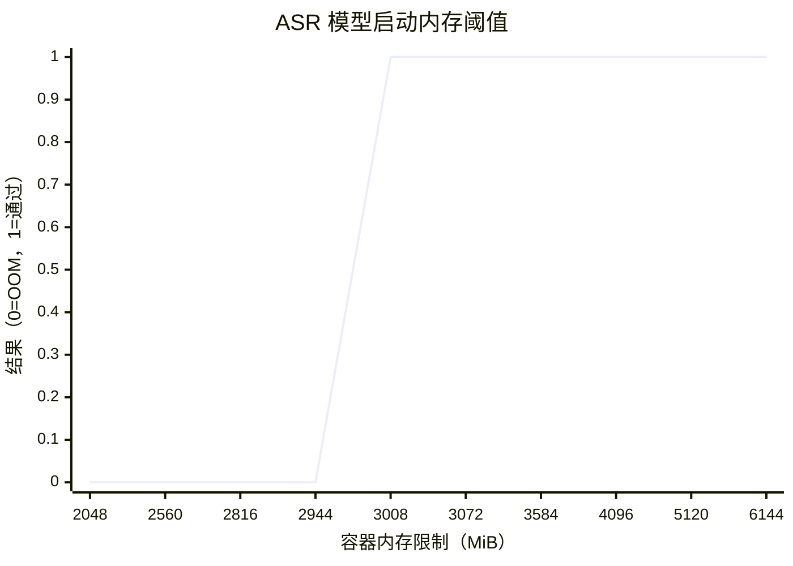
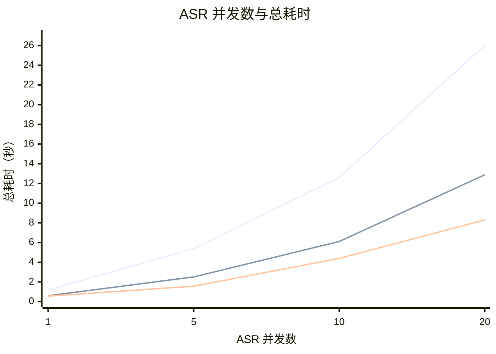
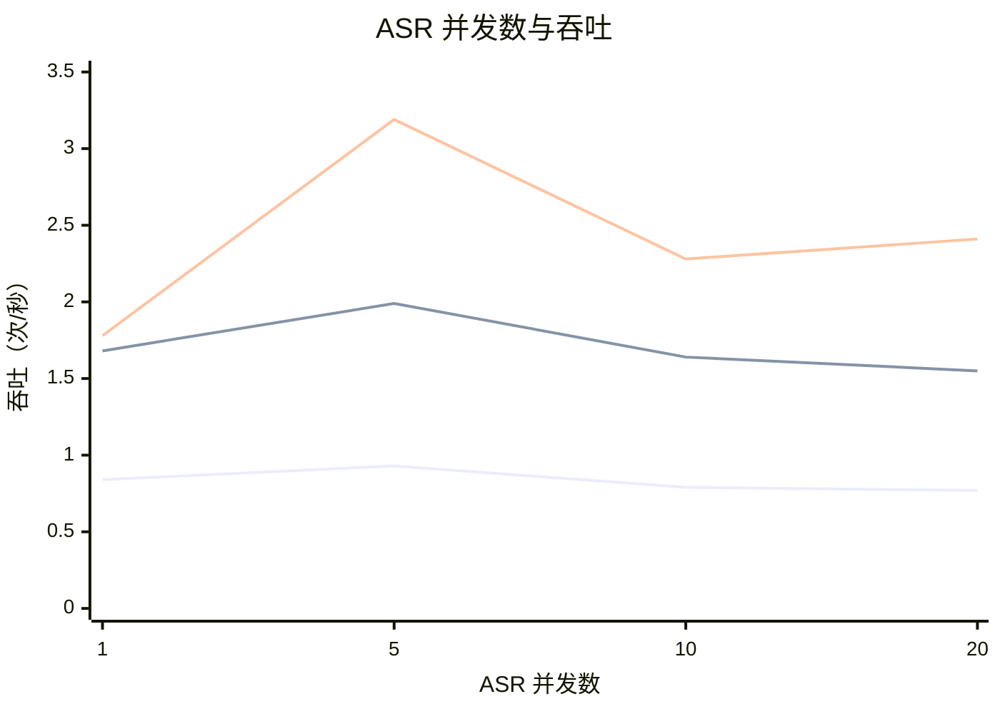

# FunASR / SenseVoiceSmall 语音识别资源与并发测试报告

测试日期：2026-07-03

## 一、测试范围

本报告针对当前 ACR 生产镜像中的本地语音识别运行时：

- 镜像：`crpi-jxcli7cptlgilqfx.cn-hangzhou.personal.cr.aliyuncs.com/yihuixiaozhi/xiaozhi-server:latest`
- ASR 供应器：`fun_local`
- 模型：`models/SenseVoiceSmall`
- 容器中观察到的 FunASR 版本：`1.2.7`
- 测试音频：`config/assets/wakeup_words_short.wav`
- 识别样例：`我在这里哦。`

所有测试都通过一次性 Docker 容器执行。测试没有修改生产 `.env`、Docker Compose 或源码。

## 二、测试输入音频规格

本次压测使用的是项目内置短音频，属于唤醒词级别的短句，不是长语音段落。

| 项目 | 值 |
| --- | --- |
| 文件路径 | `main/xiaozhi-server/config/assets/wakeup_words_short.wav` |
| 文件大小 | 49,964 bytes |
| 音频时长 | 1.56 秒 |
| 编码 | PCM signed 16-bit little-endian (`pcm_s16le`) |
| 采样率 | 16,000 Hz |
| 声道数 | 1，单声道 |
| 位深 | 16-bit |

因此，本报告中的延迟曲线代表 1.56 秒短音频的识别表现。更长的用户语音会增加特征提取和模型推理时间，实际耗时通常会随音频时长上升。

## 三、当前生产状态

当前生产 `xiaozhi-esp32-server` 容器资源限制：

```text
memory=2147483648
memorySwap=2147483648
nanoCpus=1000000000
```

等价配置：

```text
XIAOZHI_SERVER_CPUS=1.00
XIAOZHI_SERVER_MEM_LIMIT=2048m
XIAOZHI_SERVER_MEMSWAP_LIMIT=2048m
XIAOZHI_FUNASR_THREADS=2
```

该配置不足以运行本地 FunASR / SenseVoiceSmall。ASR 真实音频测试请求可以建立 HTTP 连接，但 Python 进程会在加载模型阶段被 OOM 杀掉，因此 Java 客户端拿不到 HTTP 响应头。

实测证据：

```text
POST /benchmark/models -> client error getting response
docker events -> container oom
container die -> exitCode=137
```

`exit 137` 表示进程收到 `SIGKILL`，在 Docker 容器中最常见原因是容器内存超限后被 cgroup OOM kill。

## 四、内存阈值测试

测试场景：启动一个全新容器，加载 `SenseVoiceSmall`，执行 1 次短音频识别。

| 内存限制 | 结果 | 峰值内存 |
| ---: | --- | ---: |
| 2048m | OOM，exit 137 | 未完成 |
| 2560m | OOM，exit 137 | 未完成 |
| 2816m | OOM，exit 137 | 未完成 |
| 2944m | OOM，exit 137 | 未完成 |
| 3008m | 通过 | 约 2954 MiB |
| 3072m | 通过 | 约 2951 MiB |
| 3584m | 通过 | 约 2951 MiB |
| 4096m | 通过 | 约 2954 MiB |
| 5120m | 通过 | 约 2950 MiB |
| 6144m | 通过 | 约 2951 MiB |

### 4.1 内存阈值曲线

下图展示不同内存限制下，模型是否能完成“加载 + 1 次识别”。`0` 表示 OOM 失败，`1` 表示通过。



这条曲线的拐点在 `3008m` 附近，但生产不能按拐点配置。因为 `3008m` 到实测峰值只有几十 MiB 余量，容易被系统页缓存、并发识别或其他模块挤爆。

结论：

- 理论最低可运行内存约为 `3008m`。
- `3072m` 虽然能通过，但距离峰值太近，不适合生产。
- 生产安全启动建议至少 `4096m`。
- 如果 ASR 使用频繁或存在多人同时说话，建议 `5120m` 起步。

## 五、并发测试

测试场景：加载一个共享的 `SenseVoiceSmall` 模型实例，然后对该模型实例同时发起多路识别。

注意：这里的“并发”指同时进入 ASR 识别的用户数，不是在线设备数。10 个设备在线但只有 1 个设备正在说话，ASR 并发就是 1；10 个设备同时说话，ASR 并发才是 10。

测试条件：

```text
内存限制：5120m
FunASR 线程数：2
```

### 5.1 延迟曲线

下图展示“同时有多少路 ASR 识别”对总耗时的影响。曲线越低，语音识别响应越快。



结论很直接：

- 1 核在 5 并发以后接近排队，10 并发已经超过 12 秒。
- 2 核可以支撑少量并发，但 10 并发已经接近 6 秒。
- 4 核在 5 并发时较稳，10 并发可运行但延迟会明显上升。

### 5.2 吞吐曲线

下图展示单位时间内可完成的短音频识别数量。曲线越高，单位时间处理能力越强。



吞吐不会随着并发无限上升。并发继续加大后，CPU 竞争和模型内部调度开销会抵消收益，表现为吞吐趋平甚至下降。

### 5.3 原始数据

| CPU 限制 | ASR 并发 | 成功率 | 总耗时 | 单条平均耗时 | 吞吐 |
| ---: | ---: | ---: | ---: | ---: | ---: |
| 1 核 | 1 | 1/1 | 1.19s | 1.19s | 0.84/s |
| 1 核 | 5 | 5/5 | 5.39s | 5.26s | 0.93/s |
| 1 核 | 10 | 10/10 | 12.60s | 12.37s | 0.79/s |
| 1 核 | 20 | 20/20 | 26.02s | 25.13s | 0.77/s |
| 2 核 | 1 | 1/1 | 0.60s | 0.59s | 1.68/s |
| 2 核 | 5 | 5/5 | 2.51s | 2.48s | 1.99/s |
| 2 核 | 10 | 10/10 | 6.11s | 5.99s | 1.64/s |
| 2 核 | 20 | 20/20 | 12.88s | 12.39s | 1.55/s |
| 4 核 | 1 | 1/1 | 0.56s | 0.56s | 1.78/s |
| 4 核 | 5 | 5/5 | 1.57s | 1.54s | 3.19/s |
| 4 核 | 10 | 10/10 | 4.39s | 4.29s | 2.28/s |
| 4 核 | 20 | 20/20 | 8.30s | 8.03s | 2.41/s |

并发测试中，内存主要维持在模型已加载后的占用范围内。随着并发增加，内存只从约 2.9 GiB 小幅上升到约 3.1 GiB；真正的瓶颈是 CPU 算力。

## 六、为什么 1 核看起来像排队

ASR 请求可以并发提交，但 1 核只有一条有效计算通道。多个识别任务同时进入后，会一起竞争同一个 CPU 核，操作系统不断切换执行，最终表现接近排队。

并发和真正并行不是一回事：

```text
并发：多个任务同时处于进行中
并行：多个任务在同一时刻真正同时计算
```

1 核时，有效 ASR 并行度接近 1，所以 5、10、20 并发的延迟几乎按任务数量增长。2 核和 4 核时，延迟曲线明显改善。

## 七、生产配置建议

| 目标场景 | 建议 CPU | 建议内存 | 说明 |
| --- | ---: | ---: | --- |
| 安全启动 + 单人测试 | 2 核 | 4096m | 生产最低安全基线 |
| 家用或少量设备，1-3 人偶发说话 | 2 核 | 4096m-5120m | 推荐起步配置 |
| 约 5 个 ASR 并发 | 4 核 | 5120m | 延迟明显优于 2 核 |
| 约 10 个 ASR 并发 | 4 核以上 | 6144m 起 | 能跑，但延迟会达到数秒 |
| 20 个 ASR 并发 | 不建议单实例承载 | 需要横向扩展 | 建议多 ASR/server 实例、云 ASR 或 GPU |

建议立即调整为：

```bash
XIAOZHI_SERVER_CPUS=2.00
XIAOZHI_SERVER_MEM_LIMIT=4096m
XIAOZHI_SERVER_MEMSWAP_LIMIT=4096m
XIAOZHI_FUNASR_THREADS=2
```

如果希望多人同时说话更稳，建议：

```bash
XIAOZHI_SERVER_CPUS=4.00
XIAOZHI_SERVER_MEM_LIMIT=5120m
XIAOZHI_SERVER_MEMSWAP_LIMIT=5120m
XIAOZHI_FUNASR_THREADS=2
```

## 八、运维注意事项

- 当前 Docker health 只检查 WebSocket 端口，不检查 `/benchmark/health`，也不检查 FunASR 模型是否能加载。因此容器显示 healthy，不代表 ASR 真实识别链路可用。
- 本地 FunASR 是大模型常驻内存。复用同一个本地模型实例时，内存不会随 ASR 并发线性增长。
- 并发用户增加后，主要下降的是识别延迟，因为 CPU 推理算力被打满。
- 如果需要低延迟支撑 10 个以上用户同时说话，建议横向扩展、使用外部 ASR 服务，或改用 GPU 加速。

## 九、清理情况

测试容器均使用 `--rm` 启动。测试结束后未残留 `xiaozhi-asr-*` 测试容器。
