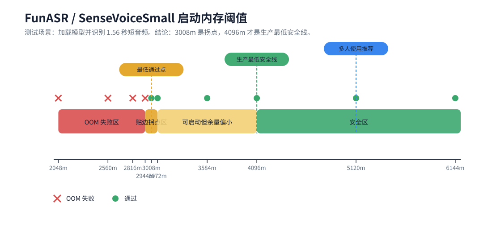
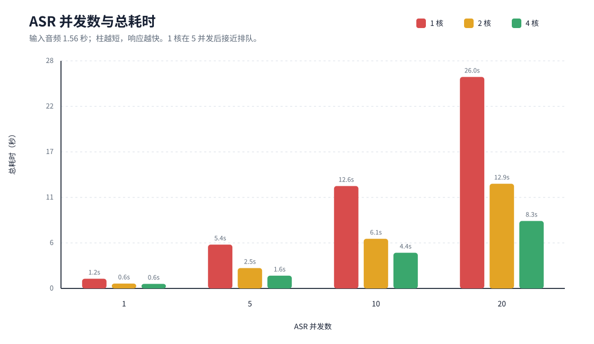
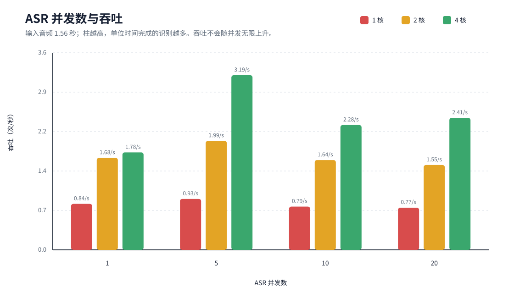
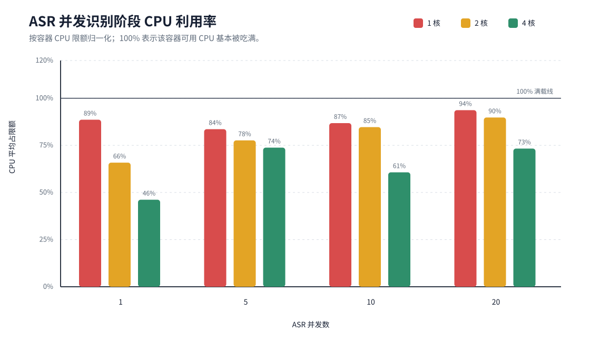
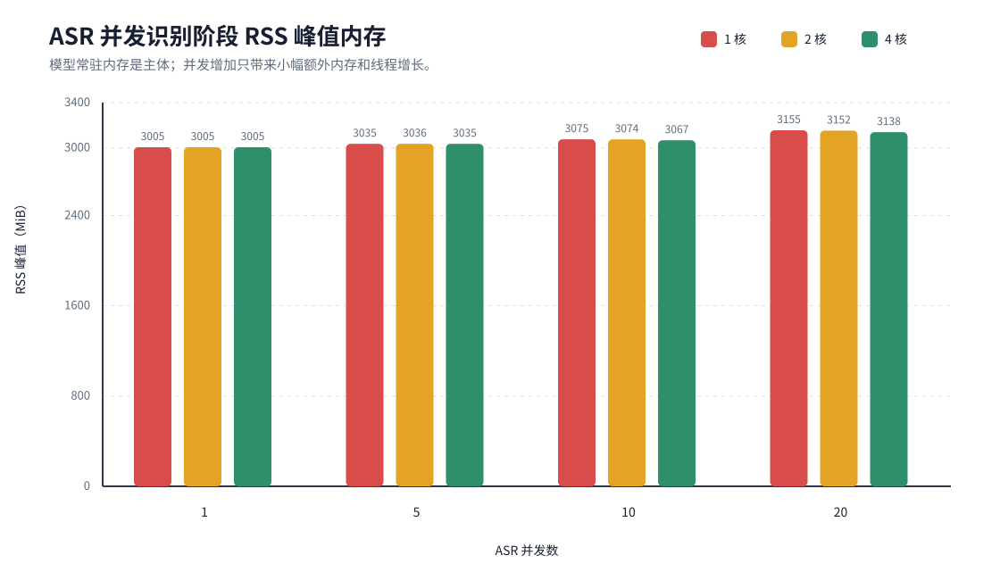

# FunASR / SenseVoiceSmall 语音识别资源与并发测试报告

测试日期：2026-07-03

## 一、测试范围

本报告针对当前 ACR 生产镜像中的本地语音识别运行时：

- 镜像：`crpi-jxcli7cptlgilqfx.cn-hangzhou.personal.cr.aliyuncs.com/yihuixiaozhi/xiaozhi-server:latest`
- ASR 供应器：`fun_local`
- 模型：`models/SenseVoiceSmall`
- 容器中观察到的 FunASR 版本：`1.2.7`
- 测试音频：`config/assets/wakeup_words_short.wav`
- 识别样例：`我在这里哦。`

所有测试都通过一次性 Docker 容器执行。测试没有修改生产 `.env`、Docker Compose 或源码。

## 二、测试输入音频规格

本次压测使用的是项目内置短音频，属于唤醒词级别的短句，不是长语音段落。

| 项目 | 值 |
| --- | --- |
| 文件路径 | `main/xiaozhi-server/config/assets/wakeup_words_short.wav` |
| 文件大小 | 49,964 bytes |
| 音频时长 | 1.56 秒 |
| 编码 | PCM signed 16-bit little-endian (`pcm_s16le`) |
| 采样率 | 16,000 Hz |
| 声道数 | 1，单声道 |
| 位深 | 16-bit |

因此，本报告中的延迟曲线代表 1.56 秒短音频的识别表现。更长的用户语音会增加特征提取和模型推理时间，实际耗时通常会随音频时长上升。

## 三、当前生产状态

当前生产 `xiaozhi-esp32-server` 容器资源限制：

```text
memory=2147483648
memorySwap=2147483648
nanoCpus=1000000000
```

等价配置：

```text
XIAOZHI_SERVER_CPUS=1.00
XIAOZHI_SERVER_MEM_LIMIT=2048m
XIAOZHI_SERVER_MEMSWAP_LIMIT=2048m
XIAOZHI_FUNASR_THREADS=2
```

该配置不足以运行本地 FunASR / SenseVoiceSmall。ASR 真实音频测试请求可以建立 HTTP 连接，但 Python 进程会在加载模型阶段被 OOM 杀掉，因此 Java 客户端拿不到 HTTP 响应头。

实测证据：

```text
POST /benchmark/models -> client error getting response
docker events -> container oom
container die -> exitCode=137
```

`exit 137` 表示进程收到 `SIGKILL`，在 Docker 容器中最常见原因是容器内存超限后被 cgroup OOM kill。

## 四、内存阈值测试

测试场景：启动一个全新容器，加载 `SenseVoiceSmall`，执行 1 次短音频识别。

| 内存限制 | 结果 | 峰值内存 |
| ---: | --- | ---: |
| 2048m | OOM，exit 137 | 未完成 |
| 2560m | OOM，exit 137 | 未完成 |
| 2816m | OOM，exit 137 | 未完成 |
| 2944m | OOM，exit 137 | 未完成 |
| 3008m | 通过 | 约 2954 MiB |
| 3072m | 通过 | 约 2951 MiB |
| 3584m | 通过 | 约 2951 MiB |
| 4096m | 通过 | 约 2954 MiB |
| 5120m | 通过 | 约 2950 MiB |
| 6144m | 通过 | 约 2951 MiB |

### 4.1 内存阈值判断



关键点：

```text
失败区：2048m - 2944m
拐点区：3008m - 3072m
安全区：4096m 起
推荐区：5120m 起
```

`3008m` 能通过，只说明这台机器和当前镜像在这次测试中刚好没有被 OOM 杀掉；它距离实测峰值只有几十 MiB 余量，生产不能按这个值配置。

结论：

- 理论最低可运行内存约为 `3008m`。
- `3072m` 虽然能通过，但距离峰值太近，不适合生产。
- 生产安全启动建议至少 `4096m`。
- 如果 ASR 使用频繁或存在多人同时说话，建议 `5120m` 起步。

## 五、并发测试

测试场景：加载一个共享的 `SenseVoiceSmall` 模型实例，然后对该模型实例同时发起多路识别。

注意：这里的“并发”指同时进入 ASR 识别的用户数，不是在线设备数。10 个设备在线但只有 1 个设备正在说话，ASR 并发就是 1；10 个设备同时说话，ASR 并发才是 10。

测试条件：

```text
内存限制：5120m
FunASR 线程数：2
```

### 5.1 延迟趋势



更清晰的解释：

| ASR 并发 | 1 核表现 | 2 核表现 | 4 核表现 |
| ---: | --- | --- | --- |
| 1 | 可用 | 很快 | 很快 |
| 5 | 已接近排队 | 可用但有延迟 | 较稳 |
| 10 | 不适合实时语音 | 明显卡顿 | 可运行但延迟上升 |
| 20 | 不建议 | 不建议 | 可完成但不适合作为实时体验 |

### 5.2 吞吐趋势



这个趋势说明：

- 1 核基本已经被单路 ASR 打满，继续增加并发只会增加等待时间。
- 2 核在 5 并发附近达到较好吞吐，之后继续增加并发，吞吐反而下降。
- 4 核在 5 并发时吞吐最好；10 并发和 20 并发虽然能完成，但单条延迟会变长。

吞吐不会随着并发无限上升。并发继续加大后，CPU 竞争、模型内部调度和线程切换会抵消收益，表现为吞吐趋平甚至下降。

### 5.3 原始数据

| CPU 限制 | ASR 并发 | 成功率 | 总耗时 | 单条平均耗时 | 吞吐 |
| ---: | ---: | ---: | ---: | ---: | ---: |
| 1 核 | 1 | 1/1 | 1.19s | 1.19s | 0.84/s |
| 1 核 | 5 | 5/5 | 5.39s | 5.26s | 0.93/s |
| 1 核 | 10 | 10/10 | 12.60s | 12.37s | 0.79/s |
| 1 核 | 20 | 20/20 | 26.02s | 25.13s | 0.77/s |
| 2 核 | 1 | 1/1 | 0.60s | 0.59s | 1.68/s |
| 2 核 | 5 | 5/5 | 2.51s | 2.48s | 1.99/s |
| 2 核 | 10 | 10/10 | 6.11s | 5.99s | 1.64/s |
| 2 核 | 20 | 20/20 | 12.88s | 12.39s | 1.55/s |
| 4 核 | 1 | 1/1 | 0.56s | 0.56s | 1.78/s |
| 4 核 | 5 | 5/5 | 1.57s | 1.54s | 3.19/s |
| 4 核 | 10 | 10/10 | 4.39s | 4.29s | 2.28/s |
| 4 核 | 20 | 20/20 | 8.30s | 8.03s | 2.41/s |

并发测试中，内存主要维持在模型已加载后的占用范围内。随着并发增加，内存只从约 2.9 GiB 小幅上升到约 3.1 GiB；真正的瓶颈是 CPU 算力。

### 5.4 容器资源消耗补充测试

为确认并发场景下到底消耗了多少 CPU 和内存，额外补跑了一轮容器内进程级采样。采样口径：

```text
测试日期：2026-07-03
内存限制：5120m
测试音频：1.56 秒 wakeup_words_short.wav
采样对象：容器内 Python / FunASR 进程
CPU 平均占限额：进程 CPU 使用率 / 容器 CPU 限额
平均用核：进程 CPU 使用率按 CPU 核数折算后的平均值
RSS 峰值：识别阶段进程常驻内存峰值，不含 Docker 镜像大小
```

注意：本节数据来自单独补跑的资源采样矩阵，用于判断 CPU、RSS 和线程消耗；由于每次容器冷启动、模型 warm-up 和系统调度略有波动，耗时数值会和 5.3 的原始延迟表有小幅差异。结论口径一致：并发增加后的主要瓶颈是 CPU，不是内存。





| CPU 限制 | ASR 并发 | 成功率 | 总耗时 | 单条平均耗时 | 吞吐 | CPU 平均占限额 | CPU 峰值占限额 | 平均用核 | RSS 峰值 | 线程峰值 |
| ---: | ---: | ---: | ---: | ---: | ---: | ---: | ---: | ---: | ---: | ---: |
| 1 核 | 1 | 1/1 | 1.61s | 1.59s | 0.62/s | 88.6% | 109.8% | 0.89 核 | 3005 MiB | 27 |
| 1 核 | 5 | 5/5 | 5.92s | 5.73s | 0.84/s | 83.6% | 114.2% | 0.84 核 | 3035 MiB | 43 |
| 1 核 | 10 | 10/10 | 13.10s | 12.62s | 0.76/s | 86.8% | 114.8% | 0.87 核 | 3075 MiB | 63 |
| 1 核 | 20 | 20/20 | 26.50s | 25.55s | 0.76/s | 93.7% | 130.4% | 0.94 核 | 3155 MiB | 103 |
| 2 核 | 1 | 1/1 | 0.81s | 0.63s | 1.24/s | 65.8% | 99.8% | 1.32 核 | 3005 MiB | 27 |
| 2 核 | 5 | 5/5 | 2.92s | 2.73s | 1.71/s | 77.7% | 104.2% | 1.55 核 | 3036 MiB | 43 |
| 2 核 | 10 | 10/10 | 6.69s | 6.51s | 1.49/s | 84.7% | 109.7% | 1.69 核 | 3074 MiB | 63 |
| 2 核 | 20 | 20/20 | 12.28s | 11.71s | 1.63/s | 89.8% | 108.2% | 1.80 核 | 3152 MiB | 103 |
| 4 核 | 1 | 1/1 | 0.60s | 0.42s | 1.66/s | 46.2% | 99.8% | 1.85 核 | 3005 MiB | 27 |
| 4 核 | 5 | 5/5 | 1.63s | 1.41s | 3.06/s | 73.8% | 104.2% | 2.95 核 | 3035 MiB | 43 |
| 4 核 | 10 | 10/10 | 4.92s | 4.62s | 2.03/s | 60.7% | 97.5% | 2.43 核 | 3067 MiB | 63 |
| 4 核 | 20 | 20/20 | 11.72s | 10.88s | 1.71/s | 73.3% | 107.5% | 2.93 核 | 3138 MiB | 103 |

资源消耗结论：

- 1 核场景下，识别阶段 CPU 平均长期处在 84%-94% 左右，已经接近单核上限；继续增加并发不会带来有效吞吐提升，只会增加等待时间。
- 2 核场景下，5 并发平均使用约 1.55 核；10-20 并发平均使用约 1.69-1.80 核，已经接近 2 核容器上限。
- 4 核场景下，5 并发平均使用约 2.95 核，吞吐最好；10 和 20 并发没有线性吃满 4 核，说明瓶颈开始转向 FunASR 内部调度、线程竞争和模型推理并发效率。
- RSS 峰值从约 3005 MiB 上升到约 3155 MiB，内存不会随 ASR 并发线性增长；模型常驻内存仍然是主体。
- 线程峰值会随并发增加，从 27 增至 103，因此高并发时除了 CPU，也要给容器保留足够的 `pids_limit` 和调度余量。

## 六、为什么 1 核看起来像排队

ASR 请求可以并发提交，但 1 核只有一条有效计算通道。多个识别任务同时进入后，会一起竞争同一个 CPU 核，操作系统不断切换执行，最终表现接近排队。

并发和真正并行不是一回事：

```text
并发：多个任务同时处于进行中
并行：多个任务在同一时刻真正同时计算
```

1 核时，有效 ASR 并行度接近 1，所以 5、10、20 并发的延迟几乎按任务数量增长。2 核和 4 核时，延迟曲线明显改善。

## 七、生产配置建议

| 目标场景 | 建议 CPU | 建议内存 | 说明 |
| --- | ---: | ---: | --- |
| 安全启动 + 单人测试 | 2 核 | 4096m | 生产最低安全基线 |
| 家用或少量设备，1-3 人偶发说话 | 2 核 | 4096m-5120m | 推荐起步配置 |
| 约 5 个 ASR 并发 | 4 核 | 5120m | 延迟明显优于 2 核 |
| 约 10 个 ASR 并发 | 4 核以上 | 6144m 起 | 能跑，但延迟会达到数秒 |
| 20 个 ASR 并发 | 不建议单实例承载 | 需要横向扩展 | 建议多 ASR/server 实例、云 ASR 或 GPU |

建议立即调整为：

```bash
XIAOZHI_SERVER_CPUS=2.00
XIAOZHI_SERVER_MEM_LIMIT=4096m
XIAOZHI_SERVER_MEMSWAP_LIMIT=4096m
XIAOZHI_FUNASR_THREADS=2
```

如果希望多人同时说话更稳，建议：

```bash
XIAOZHI_SERVER_CPUS=4.00
XIAOZHI_SERVER_MEM_LIMIT=5120m
XIAOZHI_SERVER_MEMSWAP_LIMIT=5120m
XIAOZHI_FUNASR_THREADS=2
```

## 八、运维注意事项

- 当前 Docker health 只检查 WebSocket 端口，不检查 `/benchmark/health`，也不检查 FunASR 模型是否能加载。因此容器显示 healthy，不代表 ASR 真实识别链路可用。
- 本地 FunASR 是大模型常驻内存。复用同一个本地模型实例时，内存不会随 ASR 并发线性增长。
- 并发用户增加后，主要下降的是识别延迟，因为 CPU 推理算力被打满。
- 如果需要低延迟支撑 10 个以上用户同时说话，建议横向扩展、使用外部 ASR 服务，或改用 GPU 加速。

## 九、清理情况

测试容器均使用 `--rm` 启动。测试结束后未残留 `xiaozhi-asr-*` 测试容器。
