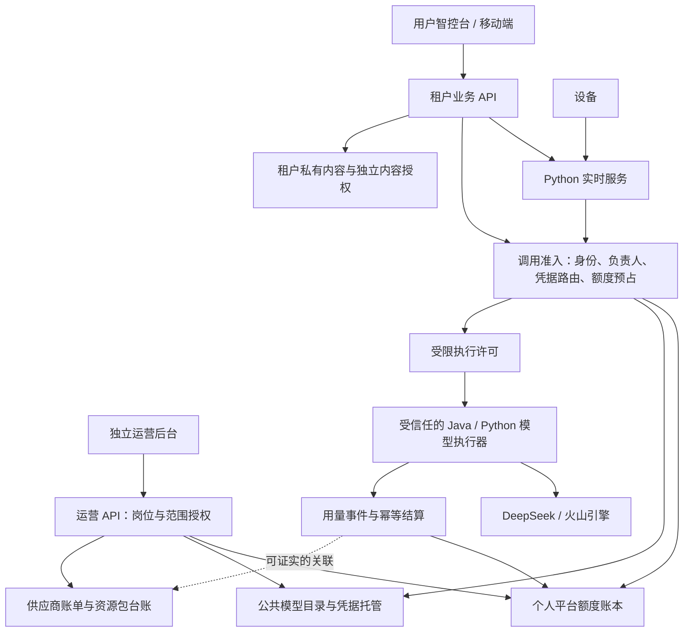

# 平台产品化规划：用户与运营分离、个人凭据、负责人额度

本文是 2026-10-12 的源码审计与目标方案，**不是已经实现或上线的能力说明**。初次规划仅整理文档，后续实现按用户确认的范围推进：当前版本不提供负责人交接。现有实现参见[项目架构](../architecture/project-architecture.md)、[工作空间说明](../architecture/workspace-organization-management.md)与[安全架构](../architecture/security-architecture.md)。

## 1. 已确定的产品规则

以下规则来自本轮用户明确决定，后续实施应以此为边界：

1. **取消超级管理员。** 目标产品没有全权角色、通配授权、跨租户内容旁路，也不通过改名保留同等能力。平台工作人员按岗位和资源范围授权。
2. 平台提供官方直连模型服务，每个产品用户拥有独立的供应商凭据及个人平台额度账户。供应商原始凭据由后端托管，不发送给浏览器、App、小程序或设备。
3. **只有工作空间：每位用户默认拥有自己的空间，可以邀请其他用户协作。调用使用所在空间固定负责人的密钥与额度。** 成员保有自己的凭据和额度，在自己负责的空间使用。
4. 工作空间承载业务资源及用量归属，工作空间不建立一份独立拥有的供应商凭据或额度余额。成员、智能体、设备的额度上限属于负责人的消费约束，不产生新余额。
5. 用户不能自行充值、提现或转账。具有相应权限的平台人员发放、调整和冻结服务额度；例如“100 元”是平台服务额度，不代表用户支付了 100 元，也不代表供应商账户余额。
6. 平台额度账与供应商实际成本账分开。先按平台服务规则记账，再按供应商提供的证据关联，不强制金额逐笔相等。
7. 用户智控台与平台运营后台独立。运营身份不因此取得聊天、音频、记忆、私有知识库等内容读取权。
8. 当前资源包管理保持查询、诊断和建议；不在本项目后台自动购买、切换资源包或更改供应商计费方式。

以甲为工作空间负责人、乙为成员举例：

| 发起场景 | 调用的供应商凭据 | 扣减的平台额度 | 用量归属 |
| --- | --- | --- | --- |
| 甲的本人工作空间 | 甲 | 甲 | 甲的本人工作空间、对应智能体/设备 |
| 乙的本人工作空间 | 乙 | 乙 | 乙的本人工作空间、对应智能体/设备 |
| 乙在甲负责的工作空间中使用 | 甲 | 甲 | 该工作空间、乙、对应智能体/设备 |
| 工作空间设备自主发起，无法确认讲话者 | 甲 | 甲 | 该工作空间、设备；不伪造人类发起者 |

甲的个人调用和其负责的所有工作空间调用共享甲的个人额度账户。甲额度不足或凭据不可用时，相应新调用暂停，**不能偷偷改扣乙的额度，也不能回退到别人的供应商凭据**。

## 2. 推荐架构及模块边界

第一阶段保留现有 Java 管理服务与 Python 实时服务，按领域拆分职责，不要求先重写为一组微服务。

这里的“模型接入层”先实现为统一的准入契约与路由组件。Python 保留语音实时链路；Java 保留配置、额度、授权和异步编排，Java 中已有的知识库/记忆模型请求也必须接入同一准入契约。需要更强凭据隔离时，再把上游调用收拢到受限的执行服务，避免两个执行栈各自解释扣费规则。

| 领域 | 推荐责任 |
| --- | --- |
| 用户业务 | 智能体、设备、工作空间知识库、工作空间成员和内容权限 |
| 员工身份与授权 | 独立员工身份、岗位权限、授权范围、审批、会话撤销 |
| 服务目录 | 经批准的供应商、模型、参数边界、平台价格版本、可用能力 |
| 凭据托管与分配 | 每用户凭据包、库存、轮换、吊销、上游标识映射 |
| 调用准入 | 验证来源、解析负责人、预占额度、签发受限执行许可 |
| 平台额度 | 发放、冻结、预占、结算、冲正和额度对账 |
| 供应商成本 | 官方账单、余额、采购、资源包抵扣证据、关联与异常 |
| 官方资源与设备发布 | 模板/知识库版本、固件发布记录、审批与回滚 |
| 内容安全 | 聊天/音频/记忆/私有知识库的资源权限、加密与内容访问审计 |

## 3. 当前代码与目标的差距

以下结论为源码事实，不等于已修复。路径中的行号以本报告日期为准。

| 当前事实 | 主要证据 | 所需改造 |
| --- | --- | --- |
| 授权主要是 `normal` / `superAdmin` 两档 | [Oauth2Realm](../../main/manager-api/src/main/java/xiaozhi/modules/security/oauth2/Oauth2Realm.java)，54–69 行 | 替换为原子权限、资源范围、独立员工会话 |
| 工作空间读、写、OWNER 判断有超级管理员直接通过；智能体另有一次旁路 | [WorkspaceServiceImpl](../../main/manager-api/src/main/java/xiaozhi/modules/workspace/service/impl/WorkspaceServiceImpl.java)，343–378 行；[AgentServiceImpl](../../main/manager-api/src/main/java/xiaozhi/modules/agent/service/impl/AgentServiceImpl.java)，368–386 行 | 同时移除服务层旁路和控制器旧授权 |
| 多个成员可以被设为 OWNER，更新角色不改 `owner_user_id`；默认空间逻辑会恢复原拥有者身份 | WorkspaceServiceImpl，293–307、419–424 行 | 统一工作空间、固定负责人、成员授权 |
| 模型配置全局共享，模型密钥按原值保存，管理详情可返回原值 | [ModelRuntimeAssembler](../../main/manager-api/src/main/java/xiaozhi/modules/model/service/impl/ModelRuntimeAssembler.java)，224–236 行；[ModelConfigServiceImpl](../../main/manager-api/src/main/java/xiaozhi/modules/model/service/impl/ModelConfigServiceImpl.java)，227–235 行 | 公共模型目录与个人凭据分离；密文存储、只写及掩码读取 |
| 完整运行配置和模型配置会进入 Redis 缓存 | [ConfigServiceImpl](../../main/manager-api/src/main/java/xiaozhi/modules/config/service/impl/ConfigServiceImpl.java)，135–139、323–332 行 | 公共配置不含个人秘密；凭据按用户与版本解析，轮换及时失效 |
| 已有不可变用量上下文，但未记录发起者、凭据所有者和额度承担者 | [BillingContextService](../../main/manager-api/src/main/java/xiaozhi/modules/billing/service/BillingContextService.java)，25–68 行 | 扩展身份快照；每次新调用重新准入 |
| 已有调用计量，但没有调用前余额预占；Python 缺上下文时可不记录用量 | [recorder.py](../../main/xiaozhi-server/core/metering/recorder.py)，81–103 行；[LlmUsageMeter](../../main/manager-api/src/main/java/xiaozhi/common/llm/LlmUsageMeter.java)，35–54 行 | 所有付费入口先授权及预占，再执行；计量补传不能代替准入 |
| 当前工作空间 quota 管智能体数量/容量 | [WorkspaceAgentQuotaService](../../main/manager-api/src/main/java/xiaozhi/modules/agent/service/impl/WorkspaceAgentQuotaService.java) | 新增个人服务额度账本，不把容量 quota 当余额 |
| 任意加入超级管理员所属工作空间的活跃成员可以获得官方资源维护能力 | [OfficialResourcePermissionServiceImpl](../../main/manager-api/src/main/java/xiaozhi/modules/workspace/service/impl/OfficialResourcePermissionServiceImpl.java)，32–54 行 | 显式员工权限，不通过租户成员关系授予平台权限 |
| 管理员重置密码接口把新密码返回给操作员 | [AdminController](../../main/manager-api/src/main/java/xiaozhi/modules/sys/controller/AdminController.java)，65–71 行 | 改为用户本人完成的找回流程，阻止间接冒充用户 |
| 音频实时预览票据只要求工作空间读权限 | [DeviceAudioPreviewTicketService](../../main/manager-api/src/main/java/xiaozhi/modules/device/service/DeviceAudioPreviewTicketService.java)，35–60 行 | 内容播放/导出/实时预览单独授权 |
| Web 的运营菜单与用户功能混合；Mobile 没有独立用户额度页 | [HeaderBar](../../main/manager-web/src/components/HeaderBar.vue)；[移动端导航](../../main/manager-mobile/src/layouts/fg-tabbar/tabbarList.ts) | 两套前端入口与 API 权限；移动端只保留用户产品功能 |

已有 [CredentialCipher](../../main/manager-api/src/main/java/xiaozhi/common/security/CredentialCipher.java) 可作为凭据加密基础，但不能把类的存在当作模型密钥已加密的证明。代码中存在 `LogOperation` 注解；本轮未找到对应完整的操作日志持久化链，审计系统需要单独验证和建设。

## 4. 彻底取消超级管理员

### 4.1 员工岗位与权限

角色只作为有限权限的组合模板。授权最终必须判断“员工身份 + 具体动作 + 资源范围 + 审批状态”，而不是判断是否属于管理人员。

| 岗位 | 可授予的职责 | 不获得的能力 |
| --- | --- | --- |
| A1 额度运营 | 额度发放/调整/冻结、用户服务状态、平台额度流水 | 供应商密钥明文、用户聊天及内容 |
| A2 供应商与凭据运营 | 凭据入库/轮换/吊销、供应商实际成本与资源包查询、对账 | 用户内容、任意修改模型请求目标；本期不提供资源包采购/切换 |
| B 官方内容运营 | 官方模板、公共知识库、音色和工具目录的编辑/送审/发布 | 租户私有草稿、私有知识库、额度及凭据管理 |
| C OTA 运营 | 固件版本入库、兼容性验证、已批准版本灰度发布/暂停/回滚 | 任意代码签名、实时监听、用户音频及对话 |
| D 服务运维 | 服务健康、容量、告警、批准版本的部署与恢复 | 生产明文内容、全局共享服务密钥、任意线上调试 |
| E 客服 | 账号状态、使用失败原因、脱敏设备及额度信息 | 密码/令牌、代用户登录、聊天和音频 |
| 权限治理人员 | 在被委派范围内提出/审批员工授权、撤销会话 | 自行审批自身提权、创造全权角色、绕过租户内容边界 |
| 审计人员 | 只读授权变更、操作审批、额度及供应商账务事件 | 凭据明文、内容正文、修改历史账目 |

例如用 `allowance.grant`、`credentials.rotate`、`supplier.bill.read`、`official.template.publish`、`ota.release.publish` 表达动作；名称为方案示例，实施时统一命名。

初期同一员工可以兼任部分岗位，但必须保留权限分项；不能把所有权限打成一个“平台管理员”包。自身提权、额度大额调整、模型目标地址发布、固件签名/发布等敏感操作按职责冲突策略限制自审自批。

平台员工权限目录中不提供 `tenant.chat.read:any` 一类全租户内容权限。若员工本人也是产品用户，必须使用独立用户身份进入本人获授权的空间，运营会话不能切换成用户会话。

员工登录要求多因素认证，敏感动作重新验证；会话包含明确用途、有效期和授权版本。岗位撤销、员工离职及审批失效后，服务端及时撤销对应会话和权限缓存，不等前端重新登录才生效。

### 4.2 权限分配和首次引导

没有超级管理员仍然可以管理权限：首次部署通过受控的一次性引导，按已批准的固定账号与有限岗位清单分配授权；引导完成状态持久化，清空用户表不能重新启用，不留下万能登录账户。日后新增员工由被委派人员提出、独立审批人按限定权限模板批准。拥有某权限与可以委派该权限分别控制，委派范围、期限和权限模板版本由后端校验，批准后不得替换目标账号或权限。权限治理人员不能扩大自己的委派范围，不能新建通配权限。

账号遗失时执行受审计、多人批准的有限身份恢复，只恢复经核验的身份及该身份当前仍有效、未撤销的受限授权；历史撤权不得因恢复重新生效，新增授权另走正常委派审批。不签发“临时全权”会话。紧急故障处置也按服务、动作和有效期授权，不能借机开放用户内容。

### 4.3 旧权限迁移顺序

1. 建立接口、后台任务和服务层权限清单，覆盖控制器注解、`getSuperAdmin()`、`SuperAdminEnum`、数值判断、前端字段以及初始化脚本。明确移除 [SysUserServiceImpl](../../main/manager-api/src/main/java/xiaozhi/modules/sys/service/impl/SysUserServiceImpl.java) 的首个注册用户自动提权（138–144 行），以及关闭注册后空用户表仍可注册的回退（290–299 行）。
2. 创建新的员工身份、岗位、权限和委派数据结构。通过新增 Liquibase 迁移演进，不修改已发布迁移；历史 SQL 中旧字段名称可以保留为历史，运行授权不得继续依赖它。
3. 明确每个旧管理账号的实际岗位，由负责人审阅迁移映射；**不能把旧 superAdmin 自动映射成所有新岗位**。没有明确映射的运营动作不授权。
4. 替换控制器权限和服务层所有权判断，同时隔离内容 API、配置下发、导出、实时音频与内部服务授权。空身份、空权限字段必须拒绝，不得视为信任。
5. 替换前端 `superAdmin` 菜单逻辑，在受控切换中停用旧实例，撤销旧会话、相关票据及缓存，关闭旧管理入口与 API。禁止“新权限 OR 旧超级管理员”的兼容授权。切换失败进入维护/修复流程，不能恢复旧内容旁路。
6. 完成否定测试后退役旧运行字段及代码，再按数据兼容计划移除旧数据库列。受影响的 canonical 架构文档在真实实施时同步更新。

特别注意：当前 [MemoryServiceImpl](../../main/manager-api/src/main/java/xiaozhi/modules/memory/service/impl/MemoryServiceImpl.java) 和 [MemoryMaintenanceServiceImpl](../../main/manager-api/src/main/java/xiaozhi/modules/memory/service/impl/MemoryMaintenanceServiceImpl.java) 的所有权检查存在依赖 `superAdmin` 非空再执行校验的分支；直接清空该字段可能跳过校验。必须先改为显式用户/服务身份授权，再退役旧字段。计费查询、热词导入和 OTA 也有注解以外的管理员判断，需要一起治理。

## 5. 个人凭据、注册与工作空间路由

### 5.1 凭据不等于供应商独立资金账户

每个产品用户可以持有自己独立的一组供应商调用凭据，但同一供应商主账号下的不同 API Key 不一定拥有独立余额、并发上限或资源包。独立 Key 主要提供访问撤销和部分用量标识能力；平台仍须自己实现个人额度与租户隔离。

公共模型目录只保留厂商、模型、能力、经批准的地址和参数模板。凭据包另存所属用户、供应商、适用能力、上游 Key/AppID/项目/Endpoint 标识、密文、版本和状态，避免给每个用户复制整套模型配置。

### 5.2 注册和凭据库存

建议流程：用户完成注册验证 → 幂等创建本人工作空间和额度账户 → 原子分配未使用凭据 → 核对所需服务能力 → 标记服务已就绪。凭据尚未齐备时明确显示“服务开通中”，用户可管理账号，付费模型调用暂不可用。

- 可按供应商官方能力采用预建库存或受限的服务端创建接口，注册请求本身不持有供应商主账户管理权限。
- 每一份上游凭据只能分配给一个产品用户；数据库唯一约束与事务/补偿任务防止并发重复分配。
- 库存耗尽、供应商配额不足或创建超时时不借用其他用户凭据；记录待处理状态、告警并幂等恢复。
- 已经分配使用的 Key 不回收后重新分配给别的用户，避免历史归属混淆；注销走吊销，轮换保留旧版本的历史映射。
- 秘密密文保存、独立密钥管理，运营后台只支持写入、替换、轮换、吊销和掩码读取。经手人工导入的人员可能知道导入值，后续应优先自动创建和托管。
- Redis 不保存可被常规运维读取的长寿命原始秘密。公共配置缓存与凭据缓存分离，用户/凭据版本/责任版本都参与隔离和失效。
- 模型调用 Key、创建凭据的管理身份、读取账单的 IAM 身份彼此分离。任何一份不能因便利而兼任其他全部职责。

### 5.3 每次调用冻结的身份

| 字段 | 含义 |
| --- | --- |
| `actorType / actorUserId / actorDeviceId` | 实际发起者；设备/后台任务无法确认用户时不虚构用户 ID |
| `workspaceId / agentId / deviceId` | 业务资源与统计归属 |
| `responsibleUserId / responsibilityVersion` | 本次解析的负责人及责任版本 |
| `credentialOwnerUserId / credentialId / credentialVersion` | 真正使用的凭据所有者和版本，不包含秘密值 |
| `payerUserId / allowanceAccountId` | 本次额度承担者及个人额度账户 |
| `ratePlanVersion / reservationId` | 内部计价规则和预占记录 |
| `logicalCallId / attemptId / providerRequestId` | 业务调用、每次真实请求、供应商请求关联标识 |

这些字段从已认证身份、资源关系及服务器路由解析，不能信任客户端传来的付款人或凭据 ID。现有 `BillingContextService` 的不可变快照适合承载历史归属，但配置获取时的快照不能无限授权后续调用。

准入结果只对指定调用、模型、用途、额度上限和短有效期生效，执行时校验。已发送调用的延迟用量上报继续接受原结算凭证；它不具备发起新调用的权限。

### 5.4 固定工作空间负责人

不划分 PERSONAL / TEAM 类型；工作空间固定负责人由 `owner_user_id` 唯一确定，`responsibleUserId` 与该归属一致，不从多个 OWNER 中随意选择。管理成员关系、查看内容和承担额度是不同权限，负责人身份本身不赋予额外私密内容权。

当前版本的负责人固定为工作空间所有者，不提供转让入口、交接申请、接收确认或交接接口。在谁的工作空间协作，就使用谁的凭据和额度。额度不足或凭据失效时暂停新调用，不改扣成员额度。

长连接的下一次模型请求、定时任务、队列任务、记忆整理和知识库处理同样重新准入；已离开工作空间的成员不能继续触发调用。队列中的未执行任务不因“早已入队”继续使用原负责人的授权。

默认工作空间可以直接邀请成员，协作不要求新建空间或转换类型。保留既有空间、业务资源及历史账目 ID；升级仅核对固定负责人和成员关系，不拆分空间，不补建另一种空间。

当前版本拒绝在工作空间仍存在时移除负责人、让负责人退出或降级其所有者角色。账号停用或额度冻结后停止新调用，已发生调用仍按原快照结算，历史账目保留。工作空间成员不因此获得负责人的完整个人余额或凭据读取权。

## 6. 平台额度账本与实时控制

### 6.1 额度的业务含义

用户看到“服务额度”“本期已使用”“预占中”“可用”，避免与实际支付充值混淆。额度运营后台记录发放人、受益人、数量、原因、政策版本、审批和有效期；如果没有到期规则就不自行引入月末清零。

平台另设经批准的发放预算池，供运营查看可发放总额、已授予、尚未使用和已消耗额度；额度发放必须同时受总池及操作员限额约束，不能任意增发。该池属于平台内部授权预算，与供应商余额独立。汇总时区分尚未分配额度和用户账户内额度，避免重复计算；撤回只影响可撤回的未用额度，不能覆盖已结算消费或破坏在途预占。

账本采用追加流水：发放、撤回未用额度、冻结/解冻、预占、扣减、释放、冲正。历史已结算记录不直接覆盖，修正通过关联冲正单。金额采用定点整数或 `BigDecimal`，定义计价精度和舍入时点。

平台价格独立版本化，明确输入/输出/缓存 Token、ASR 时长、TTS 字符和实时服务的计量规则、生效时间、失败/重试处理。缺少可靠计量的付费适配器在补齐之前不对受限账户开放，不根据静默缺字段把费用当成零。

成员/智能体/设备日限额及工作空间消费上限是个人账户内的限制。它们与个人余额同时校验、原子更新，不能通过多工作空间或本人工作空间并发绕过上限。工作空间普通成员界面不展示负责人的个人总余额；展示本人/工作空间获准看到的用量与可用状态，负责人可以单独设置工作空间预算上限。

### 6.2 付费调用流程

1. 校验用户、设备或任务身份以及资源权限，解析当前负责人和所需服务。
2. 按该用户凭据选择允许的上游路由，并按本次平台价格确定可执行的用量上限。
3. **按个人付款账户原子预占**，同时校验工作空间/成员/设备限制；同一负责人所有空间共享并发约束。
4. 持久化预占与身份快照，签发执行许可，执行器取得对应版本凭据后调用。
5. 采集实际用量，按冻结的平台价格幂等结算内部额度，释放剩余预占。
6. 供应商实际成本随后由官方账单同步/导入，再关联调用证据；不阻塞平台额度日常结算。

预占是内部额度锁定，不是供应商实际消费金额。LLM 的输入预算和最大输出、ASR 的时长、TTS 的输入长度必须有边界；流式 ASR/实时会话分段续占，续占失败就停止新增付费处理。需要为在途数据和协议结算延迟保留明确上限，不能只在会话结束后检查余额。

### 6.3 异常、重试与后台服务

- 每次供应商请求保留独立 attempt；逻辑调用保持同一 ID。内部扣费是否覆盖重试由平台规则明示，重复事件不能重复扣减，供应商真实重试成本单独保留。
- 供应商已收到请求但返回未知时进入待核对，不能立即当作零费用释放；通过状态查询、补报或经授权的冲正处理，设置处理时限及告警。
- 额度服务不可用时，新付费调用拒绝；已准入调用仅在已预占范围内完成。持久事件队列支持故障后结算，防止成功调用因记账失败被业务自动重发。
- 零额度仍保留登录、查询、导出本人获授权数据和额度查看能力。余额不足提示用本地界面/预置音频，不能为播报“额度不足”继续调用付费 TTS。
- 记忆整理、摘要、Embedding、知识库切片、视觉、克隆音色和工具内模型请求均纳入能力清单；当前未获用户授权的后台收费任务不得默认开启。
- 平台官方内容构建、测试和评测使用明确的平台内部服务预算与专用服务凭据，独立标注用途；不冒用某个客户账户，也不创造能访问客户内容的万能服务身份。

## 7. 供应商真实成本与资源包

供应商成本账只记录有来源的官方金额：账单、正式用量金额导出、资源包订单及抵扣明细。界面区分账期、币种、含税口径、应付、已付、优惠/抵扣、同步时间和覆盖范围，不能把余额变化直接当调用费用。

资源包采购现金流与资源消耗分别列示，防止同一笔采购既算采购支出又重复算调用现金支出。如果供应商未提供逐调用实际金额，按比例分摊的数字不能叫“该用户的实际供应商消费”。未匹配的账单保持“未关联”，历史调用身份未知时不按现任负责人补造。

同一负责人在本人工作空间和多个工作空间使用同一 Key 时，供应商按 Key 出具的金额仍是这些空间的合计。工作空间、成员、智能体、设备的实际用量及平台额度扣减可以由本系统精确记录；供应商成本只有在官方证据支持相应粒度时才能进一步拆分，不能因为拥有独立 Key 就承诺逐智能体的实际成本。

| 台账 | 主用途 | 对用户端的展示 |
| --- | --- | --- |
| 个人平台额度 | 额度发放与服务消耗、预占、限制 | 本人及获授权工作空间的额度/用量 |
| 供应商实际成本 | 官方应付/已付、抵扣、采购和对账 | 默认留在运营后台，不混入用户余额 |
| 供应商余额与资源权益 | 现金/赠金、资源包余量、有效期、适用范围 | 一般不展示；由平台保障服务可用性 |

资源包诊断按“实际调用使用的供应商账号、服务、AppID、项目、Endpoint、模型版本、地域、计费规格和有效期”检查可得条件。报告“可能不匹配”的原因及证据；没有官方抵扣明细时不能仅凭包有余额就认定应当抵扣，也不能认定 API Key 隔离必然带来包隔离。

运营看板建议优先展示：额度发放/使用/预占、供应商已确认成本、对账覆盖率、待结算异常、资源包临近过期、符合条件却持续现金付费的线索、库存和供应商余额告警。优化建议保持人工决策，不自动变更供应商计费设置。因为用户不充值，不能把发放额度当营业收入，再计算虚假的利润率。

### 7.1 官方公开文档核实结果

以下资料核查于 2026-10-12；供应商能力不能直接当作本项目已经接入的能力。

| 供应商能力 | 已核实事实与来源 | 对实施的影响 |
| --- | --- | --- |
| DeepSeek 账号与 Key | [服务协议 §2.4、§6](https://cdn.deepseek.com/policies/zh-CN/deepseek-open-platform-terms-of-service.html)说明账号创建 Key、账号资金扣费；上游 Key 不应暴露给终端用户。[限速说明](https://api-docs.deepseek.com/zh-cn/quick_start/rate_limit)明确并发限制按账号，与 API Key 无关 | 为用户托管独立 Key，但不能把 Key 当独立供应商钱包，也不能靠增加 Key 绕过账号并发限制 |
| DeepSeek 余额与用量 | [余额接口](https://api-docs.deepseek.com/api/get-user-balance)提供账号余额；[官方 FAQ](https://static.deepseek.com/faq/index.html?lang=zh#/question/key-usage)说明按 Key 查看/导出用量 | 原生导出字段、币种和金额口径尚需样本验证；不能用余额减法或 Token 单价推算冒充真实账单 |
| 方舟普通 API Key | [管理 API Key](https://www.volcengine.com/docs/82379/1361424)列出项目、模型/Endpoint、IP 等访问限制；主账号默认 50 个，可申请扩容 | 先按预期用户规模核实配额；该数值不能直接套用到 IAM API Key |
| 火山 IAM API Key 开通 | [CreateApiKey](https://www.volcengine.com/docs/6257/2550944)支持为指定 IAM 用户创建，返回 Id/Secret，Secret 仅创建时返回；超限返回 `LimitExceeded` | 可以评估官方自动开通，不依赖浏览器脚本；须独立控制创建身份的权限、幂等补偿和实际配额 |
| 方舟 Key 分账 | [IAM API Key 最佳实践](https://www.volcengine.com/docs/82379/2668093)说明按 API Key ID 或 Endpoint 查看费用分账；IAM API Key 本身没有 Project，直接 Model ID 调用归默认项目，自定义 Endpoint 调用归 Endpoint 所属项目 | 具备细粒度对账依据，但现有 `ListBill/ListBillDetail` 能否取到这些维度仍需字段与账期联调，不能据此宣称本项目已经逐 Key 精确对账 |
| 豆包语音 Key | [CreateAPIKey](https://www.volcengine.com/docs/6561/1801958)提供语音 API Key 创建能力，参数含 ProjectName/Name | 与 IAM 的 CreateApiKey 是不同接口；必须按实际启用的 ASR/TTS 协议验证独立凭据，不假设所有旧 AppID/Token 接口都能直接替换 |
| 语音分账和资源包 | [项目账单说明](https://www.volcengine.com/docs/6561/1339608)支持按项目分类，项目信息附到账单存在 3～4 小时延迟；[资源包状态接口](https://www.volcengine.com/docs/6561/1801938)按项目、资源和类型查询，返回 IsShareable | AppID、Key、项目与资源包是不同范围；独立 Key 不自动意味着独占资源包，包适配和共享规则需联合核对 |

尚未确认 DeepSeek 普通 Key 的官方自动创建 API、数量上限或按 Key 的人民币硬预算。首期按官方控制台创建后受控入库，不能假设能无限批量发 Key。[IAM 限制说明](https://www.volcengine.com/docs/6257/1285191)中的每用户 2 个 Access Key 是 AK/SK 配额，不能误写为 API Key 配额。

发行前需要完成三项供应商接入验证：预期用户规模下的独立凭据配额和开通方式；实际启用 LLM/ASR/TTS 的鉴权、撤销与资源包适配；账单/导出维度和延迟对账样本。未满足某项服务的独立凭据要求时，该服务保持未就绪，不以共享他人 Key 代替用户已确认的产品规则。本轮未对真实账号执行这些开通或付费测试。

## 8. 两套产品界面

| 功能 | 用户智控台 | 平台运营后台 |
| --- | --- | --- |
| 首页 | 本空间智能体/设备、额度状态、使用入口 | 按员工岗位显示待处理事项与服务指标 |
| 智能体 | 使用和配置业务行为，选择批准模型/服务档位 | 公共服务目录、能力开通、价格版本、适配器和平台评测 |
| 模型密钥、供应商参数 | 只显示服务是否就绪；不展示供应商配置表单 | 托管状态、库存、轮换、撤销及受控路由管理 |
| 额度与用量 | 本人额度；工作空间明确“由负责人承担”；按空间/成员/智能体/设备筛选 | 额度发放、政策、异常结算、官方成本、资源包诊断 |
| 设备 | 绑定、业务配置、在线状态、查看可用升级/安装已批准版本 | 兼容性矩阵、固件发布、灰度、暂停及回滚 |
| 模板和知识库 | 私有内容管理、使用官方已发布资源 | 官方资源编辑、审批、版本发布，不读取租户私有内容 |
| 工作空间 | 成员、角色；固定负责人管理工作空间限额 | 服务状态和经授权的身份异常处理，不能替用户加入工作空间 |
| 聊天和记忆 | 按独立内容权限进入相关智能体/空间页面 | 没有用户正文、音频、记忆、检索调试入口 |
| 系统与运维 | 个人账号、隐私、通知设置 | 系统参数、字典、服务状态、权限、审计 |

推荐保留 `manager-web` 为用户智控台，新增独立运营前端模块（路径在实施时确定）；构建产物、导航、登录会话用途与 API 范围分开，可使用不同域名。后端首期可以同一个 Spring 应用，必须显式区分用户、员工、内部服务身份；用户会话不能调用员工接口，员工会话不能调用租户内容接口。隐藏菜单不构成隔离。

移动端专注用户端：保留智能体首页，围绕“设备、工作空间、我的”整理入口；“我的”包含额度与用量、账号和隐私设置，不塞供应商总账。当前 H5/App 的自由服务器地址设置迁往开发配置，正式发行固定受信任服务端；小程序目前已隐藏该项。

官方模板、知识库、工具目录和固件采用不可变发布版本。用户空间引用明确版本，升级可预览并按规则确认，不能一次官方修改悄悄改变所有工作空间的私有业务行为。

## 9. 运营不可读取用户内容的实现边界

### 9.1 产品和 API 层必须完成的隔离

- 内容读权单独检查：聊天正文及标题/摘要、音频播放/下载/实时预览、记忆及来源、私有知识库原文/分块/检索测试、维护 trace 和附件。付费负责人、工作空间管理员、普通使用者不自动等价于全部内容可读。
- 运营统计只使用必要的脱敏标识、数量、时长、状态和金额，不把对话标题、用户提示词或私有知识库名称写进财务报表。
- 取消返回新密码、可登录令牌的客服功能，禁止员工代用户登录或强制加入租户工作空间。找回由用户本人通过已验证渠道完成，联系方式变更同样防止身份接管。
- 聊天、音频和私有资源使用内容范围票据，短时有效、限制动作；运营身份不能签发该票据。账单下载与聊天导出是不同权限。
- 运行日志、APM、错误堆栈采样、调试工具、备份和对象存储不能成为旁路；内容加密、独立密钥管理和访问审计一起实施。只在数据库里加密、但把解密密钥交给同一个运维账号，达不到隔离目标。
- 替换或收窄全局共享服务密钥，使用受限服务身份和资源/动作授权；设备与智能体关系校验不能代替服务调用者权限。

### 9.2 能改运行行为的岗位同样需要边界

凭据管理员不能把模型目标地址随意改到自己的服务器。官方模板/工具维护者不能发布未审查的数据外传工具。OTA 发布人员不能单独签发任意固件，必须限制到经审查的构建产物、兼容硬件和可追溯签名；设备验签能力需要到对应固件项目核实。支持与权限岗位不能通过恢复账号或新建成员关系间接读取内容。

应用运行时必须处理音频、提示词和回复，上游官方供应商也会收到所调用服务需要的内容。岗位权限、内容加密和受控发布可以阻止日常运营访问；**普通服务器架构不能承诺拥有宿主机 root 或任意代码发布权限的人绝对拿不到运行时明文**。如需更强保证，要评估机密计算与远程证明、独立 KMS，或改变端云处理方式；详见[聊天数据安全参考](../architecture/chat-data-security-reference.md)。这些基础设施访问权不应作为普通运营岗位常驻权限发放。

## 10. 数据与服务演进建议

以下为领域设计建议，不是本轮新增的表，也不是要立即执行的迁移 SQL。

| 领域对象 | 关键约束 |
| --- | --- |
| 员工身份、角色、原子权限、委派、审批 | 与产品用户会话分离；无通配/超级管理员；资源范围和有效期 |
| 用户服务账户 | 每用户个人额度账户；状态与财务余额分开 |
| 凭据库存、用户凭据及版本 | 分配幂等；唯一用户归属；密文；历史版本保留非秘密映射 |
| 空间类型、负责人及责任历史 | 固定工作空间负责人；责任快照版本与生效时间 |
| 平台发放预算、价格版本与额度政策 | 总池与操作员发放上限；不覆盖既有价格；额度有效期/上限/重试规则可追溯 |
| 额度发放、流水、预占、结算 | 幂等键、事务约束、追加记录；不能靠浏览器计算余额 |
| 调用归属与 attempt | 发起者、空间、智能体、设备、凭据所有者、付款者的不可变快照 |
| 供应商账单、订单、抵扣与关联 | 保存官方证据、来源版本、覆盖状态；未关联可独立存在 |
| 官方资源与 OTA 发布 | 不可变版本、审批、签名/摘要、灰度和回滚记录 |
| 审计事件 | 谁对什么资源做何动作、结果及审批；无秘密和用户内容正文 |

已有用量记录、账单导入/同步、补传队列和作用域校验继续复用。新增调用准入与凭据路由组件，不把余额锁、IAM、模板发布都塞进现有模型配置或中央连接巨型文件。

## 11. 实施顺序和发布验收

| 阶段 | 可验收交付 | 关键门槛 |
| --- | --- | --- |
| P0 权限与数据边界 | 有限员工角色；内容权限；取消旧全权旁路；秘密加密；明确空间/负责人模型 | 员工所有岗位组合都无法获得租户内容权限；旧会话失效，空身份拒绝 |
| P1 凭据与额度执行 | 用户独立凭据开通、负责人路由、个人账本、调用前预占、所有付费入口接入 | 无跨用户借 Key/扣费；并发、重试、轮换、故障结算正确 |
| P2 产品界面与发布治理 | 用户/运营两套入口；用户额度页；官方资源与 OTA 受控发布 | 前后端权限一致；无密钥/供应商总账泄露；角色只能操作授权范围 |
| P3 成本与智能运营 | 供应商细粒度对账、资源包诊断、容量和补贴成本分析 | 每个实际金额有官方证据，无法关联的诚实留空；不自动购买或切换 |

P0、P1 以及 P2 中最小用户/运营隔离是正式开放受限模型服务前的共同门槛，不能先公开上线后再补额度准入或内容隔离。更强运行时隐私若成为发行承诺，则相应基础设施改造也必须前置。

验收至少覆盖：

1. 个人与工作空间四类调用样例；伪造空间/付款人/凭据标识均被拒绝。
2. 同一负责人在本人工作空间与多个工作空间并发发起调用，预占总额不突破可用额度；成员个人额度保持不变。
3. 重复注册、并发分配、Key 库存用尽、创建超时、轮换与吊销；绝不串用凭据。
4. LLM 流式断开、ASR 长流、TTS 多句并行、供应商超时和补报；重复结算、重复授额不产生双重记账。
5. 负责人冻结或凭据吊销后拒绝新调用与续占；在途调用保留原归属和结算证据，禁止转扣工作空间成员。
6. 所有工作人员直接请求用户 API、签发音频票据、导出私有知识库、重置密码取登录能力都被拒绝；无前端隐藏后的服务端旁路。
7. 权限治理人员不能自授/自批超范围权限，角色组合不能形成内容全权；首次引导不能重新使用。
8. 日志、缓存、报表、导出、APM 与运营详情不含原始秘密或私密正文；跨空间、跨用户和服务身份越权测试。
9. 官方模板/工具与模型地址不能绕过审批外传数据；OTA 未批准产物不能发布，设备验签边界有明确验证结果。
10. 供应商账单延迟、资源包抵扣、退款/调整、导入重复和未关联调用；内部额度与真实成本口径始终分开。

## 12. 本轮范围和验证

本轮多智能体分别审计后端权限与隐私、凭据与额度/前端分工、官方供应商能力；集成者复核关键源码并整理本报告。未使用真实密钥、未创建供应商资源、未执行付费调用、未修改应用代码、未提交推送或部署。

已通过 `git diff --check`、本报告相对链接/标题层级检查及敏感值模式检查。`bash scripts/docs-check` 修改前后均有相同的 5 项既有问题：仓库事实过期、两处 maintenance-agent README 断链、协议文档和活动提示词报告未被索引；本报告没有新增检查失败。仅修改文档，未启动应用或运行 Java/Python/Web/Mobile 测试。已有 README、移动端及交接文档改动均保留，未清理任何既有文件或运行产物。
